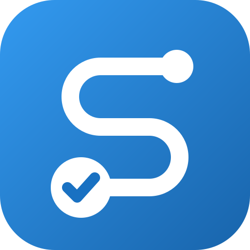

<p align="center"></p>

<h1 align="center">Steward</h1>

<p align="center"><em>Repeatable, auditable service procedures for your platforms.</em><br>
Open source under the <a href="LICENSE">Apache License 2.0</a> · Made in Erlangen, Germany</p>

Steward runs the standard procedures of a service team against **Siemens Insights Hub**, **Industrial Edge Management** and any other REST platform: onboarding users, access reviews and housekeeping, attribute-consumption checks, health checks and status tests. Each procedure becomes a versioned process. You run it on demand or on a schedule, a person approves or selects items where needed, and every run leaves a tamper-evident protocol.

It runs on a laptop as a desktop app, or as a shared team server (container, PostgreSQL, single sign-on). Around the procedures it keeps what a service team needs to run them well: a service catalogue, monitors, documents and the evidence for audits.

## The core idea

Every change goes the same way:

1. **Dry run.** Read calls run; write calls are only recorded. You see exactly what _would_ change.
2. **Decision.** A person picks the items or approves the change – with a four-eyes rule where it matters.
3. **Write.** Only the approved changes are sent, with the platform's stored credentials.
4. **Re-read.** The run reads the result back and records checks that pass or fail.
5. **Sealed protocol.** The run protocol (inputs, every request, decisions, checks, evidence) is sealed with a fingerprint in the HMAC-chained audit log, so a later change is detected. PDF/A reports and evidence packs can be verified outside Steward.

## What it does

- **Procedures.** A flow editor and YAML for versioned processes: API calls with OpenAPI help, database queries, approvals and selections, checks, reports, browser steps, manual steps, sub-processes and AI steps. Runs are journaled and resume after a restart. [Writing processes](docs/PROCESSES.md)
- **Platforms.** Any REST API with its OpenAPI specs, credentials in an encrypted vault, connector types to share a set-up, and recorded responses for test runs. [Platforms](docs/PLATFORMS.md)
- **Schedules and triggers.** Cron schedules with time zones, and webhook triggers that start a process from an alert. [Users and access](docs/USERS.md#who-may-do-what), [Gatus](docs/GATUS.md)
- **Monitors.** Dependency-aware health checks that name the root cause and keep follow-up alerts quiet, maintenance windows, availability objectives and status pages. [Monitors](docs/MONITORS.md)
- **Catalogue and registers.** Services, applications, systems with their tech stack, end of life and version watch, data contracts, documents (change requests, decision records, incident reviews), credentials, ticket references, duties and costs. [Applications](docs/APPLICATIONS.md), [Documents](docs/RECORDS.md)
- **Compliance and evidence.** Access changes, reconciliation, control catalogues, firewall changes and signed evidence packs for ISO/IEC 27001, IEC 62443 and NIS2 audits. [Compliance](docs/COMPLIANCE.md)
- **Dashboards and reports.** Datasets published by processes, dashboards with trends and forecasts, PDF/A reports of runs and scheduled reports. [Dashboards](docs/DASHBOARDS.md), [Reports](docs/REPORTS.md)
- **Notifications.** In the app, by e-mail, Microsoft Teams and webhooks, with daily summaries, quiet hours and approvals from Teams. [Notifications](docs/NOTIFICATIONS.md)
- **APIs and AI.** A read-only REST API (`/api/v1`), an MCP server for AI assistants whose writes a person approves, and AI model steps within budgets. [API](docs/API.md), [MCP](docs/MCP.md), [AI models](docs/AI.md)

All pages, grouped by task: **[documentation index](docs/README.md)**.

## Quick start (demo with simulated platforms)

Requirements: **Node.js 24 (LTS)**, the primary version, or Node.js 26 (Current, tested in CI). Steward uses the built-in SQLite. Windows, macOS and Linux are supported.

```bash
npm install
npx playwright install chromium   # only needed for browser automation
npm run demo
```

Then:

1. Open <http://127.0.0.1:4310>. Choose a master passphrase and create the first administrator account.
2. Click **Load demo platforms & processes** on the dashboard. This adds simulated platforms (Insights Hub, Industrial Edge Management and others), all templates, monitors, dashboards, three example services with their documents, credential register entries, duties, a maintenance window and a status page, and demo users:
   - `dana` (designer)
   - `olivia` (operator)
   - `adam` (approver)
   - `audrey` (auditor)
   - `vera` (viewer)

   All of them have the password `Demo-password-1`. Olivia and Adam are in the team _Service Desk_.

3. Open **Processes → "Insights Hub – Access review 1"** and click _Run_. Keep _Dry run_ on the first time.

To set up a real installation step by step – unlock, single sign-on, teams, the first platform and process, monitors, notifications and backups – follow **[Getting started](docs/GETTING-STARTED.md)**. Then plan the team's first days with **[Your first week with Steward](docs/FIRST-WEEK.md)**.

## Ways to run it

- **Desktop executable:** download, double-click; it opens as an app window. [Desktop executable](docs/INSTALL.md#1-desktop-executable)
- **Installed web app:** in Edge or Chrome choose _Install_. [PWA](docs/INSTALL.md#2-installed-web-app-pwa)
- **Node.js:** `npm install && npm run build && npm start`. [Node.js](docs/INSTALL.md#3-nodejs)
- **Container:** `docker compose up -d` with the signed image `ghcr.io/vxrz/steward` (linux/amd64 and linux/arm64). [Container](docs/INSTALL.md#4-container)
- **Database:** SQLite by default, PostgreSQL for a shared installation. [Database](docs/INSTALL.md#5-database-sqlite-or-postgresql)

Every setting is an environment variable: [docs/CONFIGURATION.md](docs/CONFIGURATION.md). Updates: [Updating](docs/INSTALL.md#6-updating); which versions get fixes: [docs/RELEASES.md](docs/RELEASES.md).

## Security

- The server binds to `127.0.0.1` by default. Credentials are encrypted with AES-256-GCM under a key that your master passphrase unlocks, and they are sent only to the platform they belong to.
- Every API call is checked against roles and access lists on the server. Sessions are bound to the browser; state-changing requests are protected against CSRF and DNS rebinding.
- The audit log is HMAC-chained with signed checkpoints, so edits, removals and re-orderings are detected.
- AI assistants change nothing by themselves: a changing call, a run start or a proposal becomes a request a person approves.

How it works in detail: [docs/SECURITY-MODEL.md](docs/SECURITY-MODEL.md). Before using it at work: [docs/SECURITY-HARDENING.md](docs/SECURITY-HARDENING.md). Personal data: [docs/PRIVACY.md](docs/PRIVACY.md). Reporting a vulnerability: [SECURITY.md](SECURITY.md).

## Contributing

Contributions are welcome – see [CONTRIBUTING.md](CONTRIBUTING.md) for setup, conventions and checks. How it is built: [docs/ARCHITECTURE.md](docs/ARCHITECTURE.md). Where it is heading and what it deliberately does not do: [docs/ROADMAP.md](docs/ROADMAP.md). Changes are listed in [CHANGELOG.md](CHANGELOG.md).

## License

Copyright 2026 uebelacker.io. Licensed under the [Apache License, Version 2.0](LICENSE). See [NOTICE](NOTICE).

Insights Hub and Industrial Edge are products of Siemens AG. Steward is an independent project and is not affiliated with or endorsed by Siemens.
