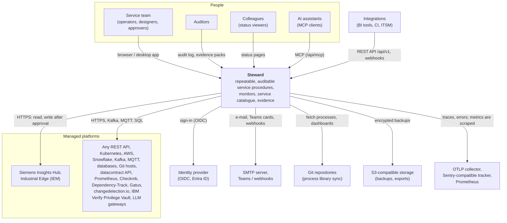
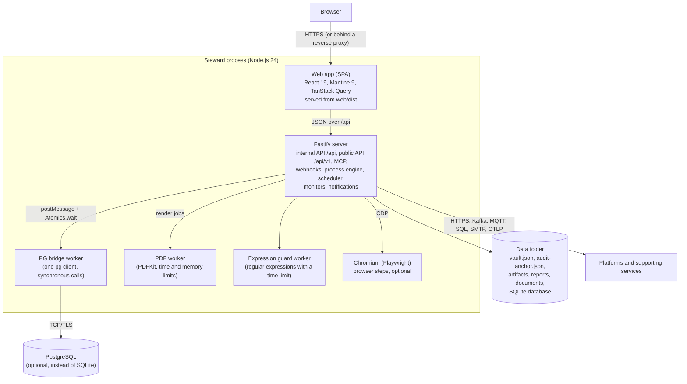
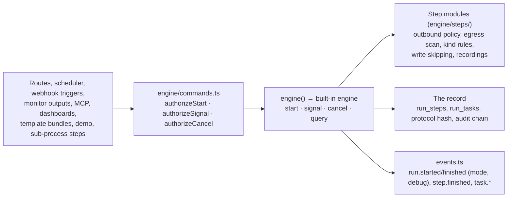

# Architecture

How Steward is built: who and what it talks to (C4 level 1), what runs where (C4 level 2), and a map of the server code. Decisions behind the design are recorded as [architecture decision records](adr/README.md).

## Context (C4 level 1)

Steward is one self-hosted application. People use it in the browser (or the desktop app); it calls the platforms it manages and a few supporting services. Nothing in it calls home.

- **People** sign in with a local password or single sign-on and act in a role (viewer, operator, designer, approver, auditor, admin), on the instance or in a team ([TEAMS.md](TEAMS.md)).
- **Platforms** are the systems Steward reads and – after a dry run and an approval – changes. Their credentials are kept encrypted in Steward's vault and only sent to the platform's own origins ([CREDENTIALS.md](CREDENTIALS.md), [PLATFORM-SIGN-IN.md](PLATFORM-SIGN-IN.md)).
- **Supporting services** are optional: the identity provider ([SSO.md](SSO.md)), SMTP / Teams / webhooks ([NOTIFICATIONS.md](NOTIFICATIONS.md)), Git ([GIT-SYNC.md](GIT-SYNC.md)), S3 ([BACKUPS.md](BACKUPS.md)), OpenTelemetry, Sentry-compatible error tracking ([ERROR-REPORTING.md](ERROR-REPORTING.md)) and Prometheus ([PROMETHEUS.md](PROMETHEUS.md)).
- **Integrations** use the public, versioned REST API `/api/v1` ([API.md](API.md)), the MCP server ([MCP.md](MCP.md)) and webhook triggers.
- **Microsoft Teams** (optional, preview): Microsoft's Bot Connector calls a second, minimal listener (`SM_TEAMS_BOT_PORT`) that serves only the bot route, for decisions inside Teams cards ([TEAMS-APPROVALS.md](TEAMS-APPROVALS.md)).

## Containers (C4 level 2)

One Node.js process serves everything. Work that would block it runs in worker threads of the same process; state lives in one database and one data folder.

| Container        | Technology                                                          | Responsibility                                                                                                                                                                                                           |
| ---------------- | ------------------------------------------------------------------- | ------------------------------------------------------------------------------------------------------------------------------------------------------------------------------------------------------------------------ |
| Web app          | React 19, Mantine 9, TanStack Query, React Flow (`web/`)            | All screens. Talks only to the internal API `/api`, which may change with every release.                                                                                                                                 |
| Server           | Node.js 24, Fastify 5, zod (`server/`, shared schemas in `shared/`) | API, sessions and route access, process engine (durable runs, approvals), scheduler, monitors, notifications, audit log, vault. Compiled to `server/dist` for production (`npm run build`).                              |
| PG bridge worker | `pg` in a worker thread (`server/src/database/pg-bridge.ts`)        | Keeps the synchronous database API on PostgreSQL ([ADR 0001](adr/0001-synchronous-db-layer-with-pg-bridge.md)).                                                                                                          |
| PDF worker       | PDFKit in a worker thread (`server/src/reports/pdf/`)               | Draws PDF/A reports off the main thread with a time and memory limit; falls back to the main thread when it cannot start.                                                                                                |
| Expression guard | worker thread (`server/src/engine/expr.ts`)                         | Runs user-supplied regular expressions with a time limit, so a pathological pattern cannot stall the server.                                                                                                             |
| Browser          | Playwright + Chromium (optional dependency)                         | Browser steps of processes; started per run with a minimal environment and its sandbox where possible.                                                                                                                   |
| Data folder      | files (`SM_DATA_DIR`, 0700)                                         | The vault file, the audit anchor, run artifacts, generated reports, uploaded documents, the SQLite database and its pre-upgrade copies.                                                                                  |
| Database         | SQLite (`node:sqlite`, default) or PostgreSQL                       | All records. Migrations are additive and named (`server/src/migrations/`). One active instance at a time: a lease on PostgreSQL, a file lock on SQLite ([ADR 0002](adr/0002-single-active-instance-with-lease-lock.md)). |

Packaging: the same server runs as a desktop executable (a Node.js single executable application with the web app and the examples embedded), from a checkout (`npm start`) and as a container image (`node server/dist/index.js`) – see [INSTALL.md](INSTALL.md).

## Module map of `server/src`

| Module                                                                                                   | What it does                                                                                                                                                                                                                                                                                                                                                     |
| -------------------------------------------------------------------------------------------------------- | ---------------------------------------------------------------------------------------------------------------------------------------------------------------------------------------------------------------------------------------------------------------------------------------------------------------------------------------------------------------- |
| `index.ts`, `main.ts`, `bootstrap.ts`, `lifecycle.ts`, `root-dir.ts`, `warnings.ts`                      | Entry point and start-up: configuration, database, vault unlock, jobs, shutdown; the phase readiness reports, the checkout root, the silenced warning of `node:sqlite`.                                                                                                                                                                                          |
| `config-schema.ts`, `config.ts`                                                                          | Every environment variable, validated once at start-up ([CONFIGURATION.md](CONFIGURATION.md)).                                                                                                                                                                                                                                                                   |
| `app.ts`, `tls.ts`                                                                                       | Builds the Fastify app (TLS options shared by every listener in `tls.ts`): request ids, security headers, host check, route access, rate limits, error handling, static web app.                                                                                                                                                                                 |
| `requestTimeout.ts`                                                                                      | Request timeouts (0.19.0): a slow request body is closed with 408 after `SM_REQUEST_TIMEOUT_SECONDS`, uploads and large routes get `SM_UPLOAD_TIMEOUT_SECONDS`; responses are not limited.                                                                                                                                                                       |
| `rateLimits.ts`, `bodyLimits.ts`, `bodyShape.ts`, `basePath.ts`                                          | Request rate limits, body size limits and limits on the shape of a body before validation; running under a path prefix (`SM_BASE_PATH`).                                                                                                                                                                                                                         |
| `instance.ts`, `instance-proof.ts`                                                                       | The instance identity, so the desktop launcher and the MCP bridge only talk to the user's own Steward.                                                                                                                                                                                                                                                           |
| `problem-json.ts`, `util.ts`, `csv.ts`, `yaml-safe.ts`, `jsonSchema.ts`                                  | Error answers (problem details), `HttpError` and small helpers; CSV without formula injection; YAML parsing with size limits; JSON Schema from zod schemas for the API and MCP.                                                                                                                                                                                  |
| `db.ts`, `database/`, `migrations/`                                                                      | The synchronous database API, SQLite and PostgreSQL drivers, the PG bridge, named migrations.                                                                                                                                                                                                                                                                    |
| `vault.ts`, `vault-rotation.ts`, `integrity.ts`                                                          | The vault: master passphrase, wrapped keys, encrypted secrets, signed settings ([ADR 0004](adr/0004-vault-with-master-passphrase.md)).                                                                                                                                                                                                                           |
| `settings.ts`, `maintenance.ts`                                                                          | Instance settings and internal setting keys; retention of runs and notifications in small batches.                                                                                                                                                                                                                                                               |
| `jobs/`, `eventloop.ts`                                                                                  | The registry of background jobs (state on _System status_, metrics, run by hand); event-loop delay measurement and protection.                                                                                                                                                                                                                                   |
| `features/`                                                                                              | The composition root: one manifest per feature and the one list that wires them ([below](#how-features-are-wired)).                                                                                                                                                                                                                                              |
| `modules/`                                                                                               | The module registry on the server ([ADR 0016](adr/0016-module-registry.md); the list is in `shared/src/modules.ts`): the switches of the optional areas, and what a signed-in person may see area by area (`visibility.ts`).                                                                                                                                     |
| `audit.ts`, `audit-anchor.ts`, `audit-export.ts`, `audit-archive.ts`, `audit-archive-verify.ts`          | Hash-chained audit log, signed checkpoints, exports ([ADR 0003](adr/0003-hmac-chained-audit-log.md)); epochs, archives and retention, and the offline check of an archive ([ADR 0017](adr/0017-audit-retention.md)).                                                                                                                                             |
| `auth/`                                                                                                  | Sessions, passwords, SSO, API tokens, step-up, route access (`access.ts`), rights and owning teams (`policy.ts`, `permissions.ts`), shares and _Restricted_ (`shares.ts`, `share-store.ts`, `share-jobs.ts`), widening and access audit (`access-change.ts`), the assurance policy (`assurance.ts`: step-up and four-eyes per control point).                    |
| `routes/`, `api/`, `api/v1/`                                                                             | Internal API routes; the public REST API with its OpenAPI document.                                                                                                                                                                                                                                                                                              |
| `engine/`                                                                                                | The process engine behind its boundary (`engine.ts`, `index.ts`, below): the built-in engine (`runner.ts`, durable, resumable), the step types (`steps/`, one module each), the command layer (`commands.ts`), the record (`store.ts`), expressions, browser steps, manual steps, checks, debug runs and comparisons ([DEBUGGING.md](DEBUGGING.md)).             |
| `processes/`, `scheduler.ts`, `triggers/`                                                                | Process versions, schedules, webhook triggers.                                                                                                                                                                                                                                                                                                                   |
| `platforms/`                                                                                             | Platform definitions, outbound HTTP (policy, credentials, recordings), connection tests, connector types.                                                                                                                                                                                                                                                        |
| `monitors/`, `gatus/`, `scorecard/`, `duties/`                                                           | Monitor graphs and their checks, Gatus integration, availability objectives and the scorecard, service duties.                                                                                                                                                                                                                                                   |
| `catalogue/`, `records/`, `tickets/`, `credentials/`                                                     | Service catalogue (applications, systems, components), documents and records, external ticket references, the credentials register.                                                                                                                                                                                                                              |
| `suppliers/`                                                                                             | Suppliers (0.17.0, [ADR 0029](adr/0029-iso-27001-support.md)): records with contacts, contracts and certificates, the links of the former free-text vendors (`links.ts`), the one-time migration of vendor texts (`migrate.ts`), reminders and the dataset ([SUPPLIERS.md](SUPPLIERS.md)).                                                                       |
| `duplicate/`                                                                                             | Duplicating items: the rules every kind follows (names, access settings, where the copy came from, audit).                                                                                                                                                                                                                                                       |
| `versions/`                                                                                              | The version watch of the tech stack: package registries, image tags, Git releases, Dependency-Track, endoflife.date; version comparison ([APPLICATIONS.md](APPLICATIONS.md#version-watch)).                                                                                                                                                                      |
| `compliance/`                                                                                            | Control catalogues, mappings, coverage and evidence packs.                                                                                                                                                                                                                                                                                                       |
| `dashboards/`, `reports/`, `reports.ts`                                                                  | Datasets and metric history, dashboards, run and scheduled reports (HTML, PDF/A).                                                                                                                                                                                                                                                                                |
| `notifications/`, `events.ts`                                                                            | In-process domain events that the engine, the scheduler and others emit and notifications and metrics consume; in-app, e-mail, Teams and webhook messages, policies, daily summaries, quiet hours and digests (outbox).                                                                                                                                          |
| `sync/`, `migration/`, `backup/`, `upgrades.ts`                                                          | Git sync of the library, moving an instance, backups (local and S3), upgrade bookkeeping.                                                                                                                                                                                                                                                                        |
| `mcp/`                                                                                                   | The MCP server, OAuth for MCP clients, the platform gateway and approved write requests; the stdio bridge.                                                                                                                                                                                                                                                       |
| `export/`                                                                                                | Postman export of processes and platforms: collections and environments without secrets ([POSTMAN.md](POSTMAN.md)); scheduled exports of readable files to S3 – the registry of parts, runs, retention ([EXPORTS.md](EXPORTS.md), [ADR 0027](adr/0027-backup-contents-and-exports.md)).                                                                          |
| `aws/`, `kafka/`, `mqtt/`, `snowflake/`, `dtrack/`, `semantic/`                                          | Clients for the platform kinds that are not plain REST; Kafka Connect (read-only) in `kafkaconnect/`, Confluent Cloud's readout in `confluent/`.                                                                                                                                                                                                                 |
| `entra/`                                                                                                 | Microsoft Graph for Entra ID: paging and throttling, access, app credentials, connection test, register import.                                                                                                                                                                                                                                                  |
| `changedetection/`                                                                                       | changedetection.io: the read-only client, the watches as components of the platform with their links, the hourly read ([CHANGEDETECTION.md](CHANGEDETECTION.md)).                                                                                                                                                                                                |
| `pvault/`                                                                                                | IBM Verify Privilege Vault: access source, hygiene, privileged use – metadata only ([IBM-PAM.md](IBM-PAM.md)).                                                                                                                                                                                                                                                   |
| `influx/`                                                                                                | InfluxDB 1.x (InfluxQL) and 2.x (Flux) for the freshness check: the queries Steward writes, the parsers of the answers, the connection test ([MONITORS.md](MONITORS.md#freshness-in-influxdb)).                                                                                                                                                                  |
| `dbms/`                                                                                                  | Database platforms: one driver per DBMS (PostgreSQL, MariaDB/MySQL, SQL Server), read-only sessions, the statement check, catalog queries, a pool per platform, the step _Query a database_ ([ADR 0008](adr/0008-database-platforms.md), [DATABASES.md](DATABASES.md)).                                                                                          |
| `dbschema/`                                                                                              | Database schemas: snapshots, breaking changes, tbls import pushed from CI, DBML and SQL DDL export ([DATABASES.md](DATABASES.md#database-schemas)).                                                                                                                                                                                                              |
| `ai/`                                                                                                    | AI models through LLM gateways: one adapter per request format, the step _Ask an AI model_, limits, budgets, the usage log, its dataset and report section ([AI.md](AI.md)).                                                                                                                                                                                     |
| `costs/`                                                                                                 | Platform costs (showback): the cost model in FOCUS columns, the connectors' readers (AWS, Snowflake, Confluent Cloud, AI gateways), FOCUS imports and push tokens, mapping, budgets, the check, the report section and the dataset ([COSTS.md](COSTS.md)); cost plans per service and fiscal year (`plans.ts`, [ADR 0026](adr/0026-service-cost-planning.md)).   |
| `system/`, `theme/`, `teams/`, `i18n/`, `buildinfo.ts`                                                   | Readiness, system status and update notice; branding; team settings; server-side translations; version and build of the running server.                                                                                                                                                                                                                          |
| `log.ts`, `telemetry.ts`, `metrics.ts`, `metrics-alias.ts`, `http-observability.ts`, `errorReporting.ts` | Logs (pino), OpenTelemetry traces, Prometheus metrics (with the deprecated metric names until 0.12), metrics and spans of Steward's own HTTP API, optional Sentry-compatible error reporting.                                                                                                                                                                    |
| `cli/`, `desktop/`                                                                                       | Command-line tools (admin, migrate, backup, db-copy, …) and the desktop launcher.                                                                                                                                                                                                                                                                                |
| `mock/`                                                                                                  | Mock platforms and identity provider for the demo and the tests (`SM_DEMO=1`).                                                                                                                                                                                                                                                                                   |
| `onboarding/`                                                                                            | The getting-started checklist of the start page and onboarding bundles (`examples/bundles/`).                                                                                                                                                                                                                                                                    |
| `plant/`                                                                                                 | The plant registry, an opt-in module (off by default): sites, ISA-95 hierarchy, buildings, assets, YAML import and export, the aggregates of its visualisations, the map of sites with its tile fetcher, cache and PMTiles reader (`map.ts`, `mapTiles.ts`, [ADR 0015](adr/0015-map-of-sites.md); [ADR 0007](adr/0007-plant-registry.md), [PLANT.md](PLANT.md)). |
| `datacontracts/`                                                                                         | Data contracts (ODCS v3): versions, the JSON Schema check, breaking changes, links, drafts, tests through the datacontract CLI's API (a container of its own), the monitor check, the process step, the report section ([DATA-CONTRACTS.md](DATA-CONTRACTS.md)).                                                                                                 |
| `libraries/`                                                                                             | Shared procedure libraries: the SSHSIG check (Node crypto), trusted publishers and their sealed keys, verifying and staging releases (Git tags, .zip), the review, the install in one transaction, rollback, Hold, provenance ([ADR 0014](adr/0014-shared-procedure-libraries.md), [LIBRARIES.md](LIBRARIES.md)).                                                |
| `msteams/`                                                                                               | Approvals from Microsoft Teams: decision cards, follow-ups, the Teams bot (preview) on its own listener ([ADR 0013](adr/0013-teams-approvals.md)); personal notifications in the bot's chat ([ADR 0025](adr/0025-personal-teams-notifications.md)).                                                                                                              |

Rules that hold across modules:

- **Route access is declared on the route** and checked before the body is read; object rights are checked in the services ([ADR 0005](adr/0005-route-access-declared-on-routes.md)).
- **Team scope is decided in one module** (`auth/policy.ts`) ([ADR 0006](adr/0006-owning-teams-policy-module.md)).
- **Optional areas are modules** in one registry (`shared/src/modules.ts`, `modules/`): switched off, their routes answer 404, their jobs do not run and the web app leaves them out ([ADR 0016](adr/0016-module-registry.md), [MODULES.md](MODULES.md)). A module that is on can be restricted to selected teams and users (`modules/access.ts`, [ADR 0034](adr/0034-module-access.md)): for everyone else its routes answer 404 `MODULE_NO_ACCESS` (the same hook in `app.ts`), and the parts its `access` declares – notification events, MCP tools, report sections, export parts, item kinds of links – leave every surface; a surface that shows module data asks `moduleAvailable(id)` where it asked `moduleEnabled(id)`.
- **One maintenance-window concept**: catalogue windows (`catalogue/maintenance.ts`) can list monitors, and the monitor engine asks only them; a Steward monitor is a source of availability objectives, with the same uptime arithmetic as the monitor and the reports (`monitors/stats.ts`) ([ADR 0018](adr/0018-one-maintenance-window-concept.md)).
- **Every change of state is audited**, attributed to the signed-in user (`audit()`).
- **Configuration comes from `env`** (`config.ts`), never from `process.env` (ESLint checks it).
- **The internal API is private**; integrations use `/api/v1` ([API.md](API.md#the-internal-api)).
- **Runs start, wake and stop through the engine boundary**: outside `engine/`, code imports `engine/index.ts`, never `engine/runner.ts` (ESLint checks it), and checks rights first in `engine/commands.ts` (below).
- **Features are wired in one place**, the composition root `features/index.ts`; no feature registers itself by being imported, and import cycles do not grow (`npm run check:imports`, [below](#import-rules)).

## The engine boundary

The process engine has one interface ([ADR 0011](adr/0011-engine-boundary.md)), `RunEngine` in `server/src/engine/engine.ts`: `start(command)`, `signal(runId, signal, actor)`, `cancel(runId, reason, actor)` and `query(runId)`, plus the host calls `recover`, `stopAccepting`, `drain` and `interruptBusy` that only `bootstrap.ts` and `main.ts` use. `engine()` from `engine/index.ts` returns the configured engine – today always the **built-in engine**, today's runner (`runner.ts`). `engine/store.ts` stays importable everywhere: it is the record, not the executor.

- **One command layer.** Every caller that starts, decides, verifies, resumes or cancels runs checks rights in `engine/commands.ts`: process `view` (else "not found"), `run`, `use` on every bound platform; `canDecide` and four-eyes for decisions; `run` (and for debug runs: the starter or an administrator) for cancelling. Debug runs ([DEBUGGING.md](DEBUGGING.md)) also need `edit`. The engine trusts its caller. Which runs and tasks a reader may see is decided once, in `engine/run-access.ts`: the internal API, the public API, MCP and decisions from Teams share it.
- **What stays in Steward, whatever the engine**: rights and assurance, secrets (`getConnection`, the vault, the `Redactor` in `engine/redact.ts`), every check on a request (they live in the step modules), the record and its seal, and what runs feed (datasets, access changes, check alerts, notifications, reports).
- **Step types are modules** (since 0.11): `engine/steps/<type>.ts`, one per step type, behind the typed registry `STEPS` in `engine/steps/index.ts`. A step sees its run only through `StepContext` (`engine/steps/context.ts`): the run and its mode, bindings, the expression evaluator, the run log, the abort signal, waiting for a task or a sub-process run. It never imports the runner (ESLint checks it). The runner keeps the loop: scheduling, the journal and replay, retries, cancellation, ports, debug pauses.
- **Events** stay the in-process `events.ts`; `run.started` and `run.finished` carry `mode` (`live`, `dry`, `test`) and `debug`. There is no outbox and no push to the web app.
- **Invariants** every engine keeps, checked by `server/test/engine-contract.test.ts` and `engine-contract-restart.test.ts` on SQLite and PostgreSQL: one journal entry per activation keyed `<scope>/<node>#n` in execution order, control decisions in `input.decision`; a finished step is never executed again; automatic recovery never re-runs a step that may have started (a `running` run becomes `interrupted`); a decision is committed before the run is woken, and a signal on a closed task changes nothing; cancel reaches the open request, open tasks and child runs and ends with one `run.cancelled` carrying its reason; child runs inherit mode, actor and the recorded flag, nesting stops at 5 and a process cannot appear twice in a chain; the protocol hash does not depend on the engine (golden hashes of example processes as test runs).
- **A durable-execution backend** (for example Temporal) is not built. ADR 0011 fixes what it would have to respect: the workflow interprets the pinned definition, every node is an activity running Steward's step functions, secrets never enter the backend's history, signals only wake, and workers run in the active instance (ADR 0002, 0003).

### Adding a step type

1. **Schema and metadata** (`shared/`): the node in `shared/src/process.ts` (`NODE_TYPES`, its fields, validation), its editor metadata in `shared/src/stepMeta.ts`, and its texts in `web/src/locales/en|de/editor.json`. For a step that calls a platform, say in `shared/src/debug.ts` which answers a single-node debug run may use (ADR 0010).
2. **The step module** `server/src/engine/steps/<type>.ts`: export a `StepExecutor<'<type>'>` with `exec(step, ctx, key, attempt)`. Use only what `StepContext` gives and `engine/store.ts` for the step's own record (`updateStepInput`, tasks, artifacts). Redact what you record (`ctx.redactor.apply`); the engine redacts the returned output and summary. Before a request leaves Steward, call `enforceOutbound` (outbound policy and egress scan, `steps/outbound.ts`), then send it with `platformRequest`; skip writes in dry runs (`ctx.dryRun`) and answer from recordings in test runs (`ctx.recorded`). Throw `Cancelled` when `ctx.signal` aborts a wait.
3. **Optional hooks**: `preview` (what a debug pause shows), `sources` (where the result comes from, for the AI allowed-data rule; default: computed from the run), `applyOutput` (what the output does to the variables, also when a resumed run replays the step).
4. **Register it** in `STEPS` (`server/src/engine/steps/index.ts`). The compiler reports a step type that has no module.
5. **The editor** (`web/src/components/flow/meta.ts`) and, where they apply, the Postman export (`server/src/export/postman.ts`) and library installs (`server/src/libraries/install.ts`).
6. **Tests**: the step's own test file, and the engine contract tests (`engine-contract*.test.ts`) unchanged.

## Platform kinds and check types

What a connector is and what a monitor check needs is written down once (since 0.11), in two descriptor tables in `shared/`. Everything else derives from them: the "Get started" panel, the platform pickers of the monitor editor, the kind a monitor import or Git sync expects, the groups of the setup wizard, the maturity badges, the hints of a failing connection test, which access check source and cost source read a platform. `server/test/descriptors.test.ts` checks that every kind and every check type has a complete descriptor and that the lists they replaced are gone.

- **Platform kinds**: `PLATFORM_KINDS` in `shared/src/platformKinds.ts`, one entry per built-in kind (`PlatformKindDef`): its product name, the wizard group, whether it has an HTTP API of its own and whether its test path answers JSON, the check, output and step types that read it, its access check source and cost source, its maturity. The wire keeps `kind: string`: an own connector type has no descriptor and gets the generic behaviour. The code of a connector that does more than HTTP is in `server/src/platforms/drivers.ts` (`DRIVERS`: today its own connection test), imported lazily.
- **Check types**: `CHECK_TYPE_DEFS` in `shared/src/checkTypes.ts`, one entry per check type (`CheckTypeDef`): name and help, the name and fields of a new check, whether it reads a platform, whether it makes a call itself, the module it belongs to. Its config schema stays its entry of `checkSchema` (`shared/src/monitors.ts`). The server's evaluator is in `CHECK_RUNNERS` (`server/src/monitors/checks.ts`), the web form in `CHECK_FIELDS` (`web/src/components/monitors/checks/`, one component per type). Both are typed records: a type missing there does not compile.

### Adding a platform kind

1. **The descriptor**: an entry in `PLATFORM_KINDS` (`shared/src/platformKinds.ts`). Name the check, output and step types that read it, its access and cost source if it has one, and start at maturity `preview`.
2. **The preset** in `server/src/platforms/presets.ts`: base URL, authentication, variables and credential fields, and its texts in `web/src/locales/en|de/platforms.json` (`presets.<key>`).
3. **A driver**, only if "Test connection" is more than `GET` on the test path: an entry in `DRIVERS` (`server/src/platforms/drivers.ts`) and `connectionTest: 'own'` in the descriptor.
4. **An access source** (optional): its name in `ACCESS_CHECK_SOURCES` (`shared/src/compliance.ts`), its collector in `COLLECTORS` and its answer for a platform of another kind in `WRONG_KIND` (`server/src/compliance/reconciliation.ts`). **A cost reader** (optional): its source in `COST_SOURCES` and its read in `server/src/costs/sources.ts`.
5. **A module** (optional): if the kind only makes sense with a module, add it to the module's `platformKinds` (`shared/src/modules.ts`).
6. **Docs and tests**: the maturity table in [MODULES.md](MODULES.md), a test against the mock server (`server/src/mock`). `descriptors.test.ts` fails until the preset and the descriptor exist together.

### Adding a check type

1. **The schema**: its entry in `checkSchema` and its name in `CHECK_TYPES` (`shared/src/monitors.ts`).
2. **The descriptor**: an entry in `CHECK_TYPE_DEFS` (`shared/src/checkTypes.ts`) with the fields of a new check. A check that reads a platform of a kind: `platform: 'kind'`, and the type in that kind's `checkTypes`; saving refuses a platform of another kind (`CHECK_PLATFORM_KIND`) and a stored one reports unknown without a request, for every such type (`server/src/monitors/kinds.ts`; output types in a kind's `outputTypes` likewise, `OUTPUT_PLATFORM_KIND`).
3. **The evaluator**: a function returning a `RawResult`, registered in `CHECK_RUNNERS` (`server/src/monitors/checks.ts`), with `plan` for a read shared by several checks and `validate` for rules that need the resolved platform.
4. **The form**: a component `web/src/components/monitors/checks/<Type>Fields.tsx` taking `CheckFieldsProps<'<type>'>`, registered in `CHECK_FIELDS`; its icon in `CHECK_ICONS` (`checkMeta.ts`); its texts in `web/src/locales/en|de/monitors.json` (`checkTypes.<type>`, `newCheck.<type>`).
5. **Tests**: the evaluator's own test file; `descriptors.test.ts` covers the descriptor, the evaluator and the form.

## How features are wired

Each feature has a manifest in `server/src/features/<name>.ts` (`defineFeature()`, the type is in `features/define.ts`). It names everything the feature brings to the rest of Steward:

| Field            | What                                                                            | Read or registered by                                    |
| ---------------- | ------------------------------------------------------------------------------- | -------------------------------------------------------- |
| `module`         | Its module in `shared/src/modules.ts` ([ADR 0016](adr/0016-module-registry.md)) | a test: the module's jobs and datasets are the feature's |
| `routes`         | The internal API under `/api`                                                   | `routes/index.ts`                                        |
| `apiV1`          | The public API under `/api/v1`                                                  | `api/index.ts` → `api/v1/routes.ts`                      |
| `jobs`           | Background jobs (their code loads when a job first runs)                        | `registerFeatureJobs()`, called by `main.ts`             |
| `reportSections` | Sections of scheduled reports (collect and draw halves)                         | `installFeatures()` → `reports/sections.ts`              |
| `datasets`       | Datasets no process publishes, and who may read them                            | `installFeatures()` → `dashboards/builtin.ts`            |
| `mcpTools`       | Tools of the MCP server, after Steward's own                                    | `installFeatures()` → `mcp/tools.ts`                     |
| `linkKinds`      | Link kinds of records, documents and tickets                                    | `installFeatures()` → `records/links.ts`                 |
| `migrations`     | Its migration lists, for ownership                                              | a test: every list has one owner                         |

`features/index.ts` is the composition root: `FEATURES` is the only list of features, and the only place that wires them. `buildApp()` (`app.ts`) calls `installFeatures()` first; the registries never import the features, the features never import the root. Only entry points import it: `app.ts`, `routes/index.ts`, `api/index.ts`, `main.ts`, the CLIs. The order of `FEATURES` is the order of the sections in a report and of the paths in `docs/openapi.json`.

The order of migrations is not the order of `FEATURES`: it is history, kept in one explicit list, `server/src/migrations/index.ts`. A new list goes at the end, a new migration at the end of its list, so an upgraded and a new database end up the same (`upgrade.test.ts` compares their schemas).

The shell of the app stays in `app.ts`: the public API's scope, MCP and its OAuth sign-in, the instance proof, theme and system status, the web app. Notification events stay a shared list (`NOTIFICATION_EVENTS` in `shared/`): the web app shows the preferences for each of them.

**Adding a feature**: write its manifest, add it to `FEATURES`, and add its module to `shared/src/modules.ts` if it can be switched off. `server/test/features.test.ts` checks the manifests against the module registry and the migration lists.

### Report sections and the PDF worker

PDFs are drawn in a worker thread (`reports/pdf/pool.ts`). It gets collected data and draws; it has no database. A section of a scheduled report therefore has two halves:

- the **collect half** (`<feature>/report-section.ts`, built-in ones in `reports/builtin-sections.ts`): the configuration schema, the checks on save and `build()`, which reads the data with the rights of the schedule's owner. It runs in the main thread and may use the database and the services.
- the **draw half** (`<feature>/report-section-draw.ts`): title, the "at a glance" figures and `render()`. Data in, PDF out. It imports no database, engine or service.

`defineReportSection()` checks that the two halves agree on the data type. The run, summary and scheduled reports and the evidence pack are split the same way (`summary-report.ts` / `summary-draw.ts`, `scheduled-report.ts` / `scheduled-draw.ts`). The worker entry (`reports/pdf/worker-entry.ts`) loads `reports/pdf/drawers.ts` – every kind of PDF and the draw half of every section – and nothing else: 35 server modules and about 18 MB heap after loading (it was 265 modules and 46 MB before 0.11; PDFKit alone is 8 MB). A section that only the main thread knows is drawn there.

## Import rules

`npm run check:imports` (`scripts/check-imports.mjs`, part of the lint job in CI) reads the sources with the TypeScript compiler API. It counts runtime imports only: `import type`, names used only as types and `await import()` do not count.

- **No new import cycles.** `scripts/import-baseline.json` lists the import edges that lie on a cycle today (13 cycles, all in the server; the web app has none since 0.20.0). The check fails on an edge that closes a new cycle, and on a listed edge that no longer lies on one: then run `npm run check:imports -- --update` and commit the smaller baseline. The list only shrinks.
- **Layer rules**: `shared/` imports neither `server/` nor `web/`; the web app and the server do not import each other; the PDF worker and every draw half reach no database, engine, service or route; `engine/` imports no compliance, reports, monitors or routes (a step that needs them imports them lazily, like the query and contract-test steps); services do not import routes; only entry points import `features/`. Accepted exceptions are in the baseline too.
- The engine boundary and the step modules keep their ESLint rules (above).

To break a cycle: import only the type, move the shared part into its own small module, register instead of importing (a manifest field), or import lazily. `--stats` prints the counts, `--from <file>` the modules a file loads at start.
