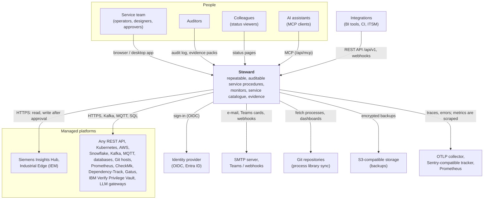
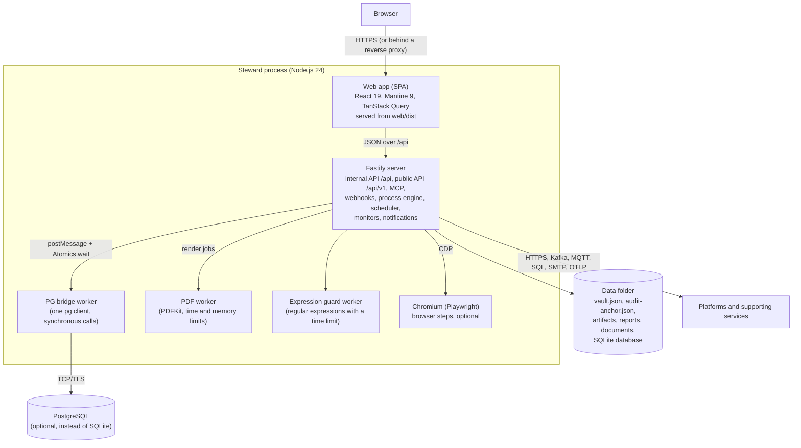

# Architecture

How Steward is built: who and what it talks to (C4 level 1), what runs where (C4 level 2), and a map of the server code. Decisions behind the design are recorded as [architecture decision records](adr/README.md).

## Context (C4 level 1)

Steward is one self-hosted application. People use it in the browser (or the desktop app); it calls the platforms it manages and a few supporting services. Nothing in it calls home.

- **People** sign in with a local password or single sign-on and act in a role (viewer, operator, designer, approver, auditor, admin), on the instance or in a team ([TEAMS.md](TEAMS.md)).
- **Platforms** are the systems Steward reads and – after a dry run and an approval – changes. Their credentials are kept encrypted in Steward's vault and only sent to the platform's own origins ([CREDENTIALS.md](CREDENTIALS.md), [PLATFORM-SIGN-IN.md](PLATFORM-SIGN-IN.md)).
- **Supporting services** are optional: the identity provider ([SSO.md](SSO.md)), SMTP / Teams / webhooks ([NOTIFICATIONS.md](NOTIFICATIONS.md)), Git ([GIT-SYNC.md](GIT-SYNC.md)), S3 ([BACKUPS.md](BACKUPS.md)), OpenTelemetry, Sentry-compatible error tracking ([ERROR-REPORTING.md](ERROR-REPORTING.md)) and Prometheus ([PROMETHEUS.md](PROMETHEUS.md)).
- **Integrations** use the public, versioned REST API `/api/v1` ([API.md](API.md)), the MCP server ([MCP.md](MCP.md)) and webhook triggers.

## Containers (C4 level 2)

One Node.js process serves everything. Work that would block it runs in worker threads of the same process; state lives in one database and one data folder.

| Container        | Technology                                                          | Responsibility                                                                                                                                                                              |
| ---------------- | ------------------------------------------------------------------- | ------------------------------------------------------------------------------------------------------------------------------------------------------------------------------------------- |
| Web app          | React 19, Mantine 9, TanStack Query, React Flow (`web/`)            | All screens. Talks only to the internal API `/api`, which may change with every release.                                                                                                    |
| Server           | Node.js 24, Fastify 5, zod (`server/`, shared schemas in `shared/`) | API, sessions and route access, process engine (durable runs, approvals), scheduler, monitors, notifications, audit log, vault. Compiled to `server/dist` for production (`npm run build`). |
| PG bridge worker | `pg` in a worker thread (`server/src/database/pg-bridge.ts`)        | Keeps the synchronous database API on PostgreSQL ([ADR 0001](adr/0001-synchronous-db-layer-with-pg-bridge.md)).                                                                             |
| PDF worker       | PDFKit in a worker thread (`server/src/reports/pdf/`)               | Draws PDF/A reports off the main thread with a time and memory limit; falls back to the main thread when it cannot start.                                                                   |
| Expression guard | worker thread (`server/src/engine/expr.ts`)                         | Runs user-supplied regular expressions with a time limit, so a pathological pattern cannot stall the server.                                                                                |
| Browser          | Playwright + Chromium (optional dependency)                         | Browser steps of processes; started per run with a minimal environment and its sandbox where possible.                                                                                      |
| Data folder      | files (`SM_DATA_DIR`, 0700)                                         | The vault file, the audit anchor, run artifacts, generated reports, uploaded documents, the SQLite database and its pre-upgrade copies.                                                     |
| Database         | SQLite (`node:sqlite`, default) or PostgreSQL                       | All records. Migrations are additive and named (`server/src/migrations/`). One active instance at a time ([ADR 0002](adr/0002-single-active-instance-with-lease-lock.md)).                  |

Packaging: the same server runs as a desktop executable (a Node.js single executable application with the web app and the examples embedded), from a checkout (`npm start`) and as a container image (`node server/dist/index.js`) – see [INSTALL.md](INSTALL.md).

## Module map of `server/src`

| Module                                                          | What it does                                                                                                                                                                                                                                                            |
| --------------------------------------------------------------- | ----------------------------------------------------------------------------------------------------------------------------------------------------------------------------------------------------------------------------------------------------------------------- |
| `index.ts`, `main.ts`, `bootstrap.ts`                           | Entry point and start-up: configuration, database, vault unlock, jobs, shutdown.                                                                                                                                                                                        |
| `config-schema.ts`, `config.ts`                                 | Every environment variable, validated once at start-up ([CONFIGURATION.md](CONFIGURATION.md)).                                                                                                                                                                          |
| `app.ts`                                                        | Builds the Fastify app: request ids, security headers, host check, route access, rate limits, error handling, static web app.                                                                                                                                           |
| `problem-json.ts`, `util.ts`                                    | Error answers (problem details), `HttpError` and small helpers.                                                                                                                                                                                                         |
| `db.ts`, `database/`, `migrations/`                             | The synchronous database API, SQLite and PostgreSQL drivers, the PG bridge, named migrations.                                                                                                                                                                           |
| `vault.ts`, `vault-rotation.ts`, `integrity.ts`                 | The vault: master passphrase, wrapped keys, encrypted secrets, signed settings ([ADR 0004](adr/0004-vault-with-master-passphrase.md)).                                                                                                                                  |
| `audit.ts`, `audit-anchor.ts`, `audit-export.ts`                | Hash-chained audit log, signed checkpoints, exports ([ADR 0003](adr/0003-hmac-chained-audit-log.md)).                                                                                                                                                                   |
| `auth/`                                                         | Sessions, passwords, SSO, API tokens, step-up, route access (`access.ts`), rights and owning teams (`policy.ts`, `permissions.ts`), the assurance policy (`assurance.ts`: step-up and four-eyes per control point).                                                     |
| `routes/`, `api/`, `api/v1/`                                    | Internal API routes; the public REST API with its OpenAPI document.                                                                                                                                                                                                     |
| `engine/`                                                       | The process engine: runner (durable, resumable), expressions, browser steps, manual steps, checks.                                                                                                                                                                      |
| `processes/`, `scheduler.ts`, `triggers/`                       | Process versions, schedules, webhook triggers.                                                                                                                                                                                                                          |
| `platforms/`                                                    | Platform definitions, outbound HTTP (policy, credentials, recordings), connection tests, connector types.                                                                                                                                                               |
| `monitors/`, `gatus/`, `scorecard/`, `duties/`                  | Monitor graphs and their checks, Gatus integration, availability objectives and the scorecard, service duties.                                                                                                                                                          |
| `catalogue/`, `records/`, `tickets/`, `credentials/`            | Service catalogue (applications, systems, components), documents and records, external ticket references, the credentials register.                                                                                                                                     |
| `compliance/`                                                   | Control catalogues, mappings, coverage and evidence packs.                                                                                                                                                                                                              |
| `dashboards/`, `reports/`, `reports.ts`                         | Datasets and metric history, dashboards, run and scheduled reports (HTML, PDF/A).                                                                                                                                                                                       |
| `notifications/`                                                | In-app, e-mail, Teams and webhook messages, policies, daily summaries.                                                                                                                                                                                                  |
| `sync/`, `migration/`, `backup/`, `upgrades.ts`                 | Git sync of the library, moving an instance, backups (local and S3), upgrade bookkeeping.                                                                                                                                                                               |
| `mcp/`                                                          | The MCP server, OAuth for MCP clients, the platform gateway and approved write requests; the stdio bridge.                                                                                                                                                              |
| `export/`                                                       | Postman export of processes and platforms: collections and environments without secrets ([POSTMAN.md](POSTMAN.md)).                                                                                                                                                     |
| `aws/`, `kafka/`, `mqtt/`, `snowflake/`, `dtrack/`, `semantic/` | Clients for the platform kinds that are not plain REST.                                                                                                                                                                                                                 |
| `entra/`                                                        | Microsoft Graph for Entra ID: paging and throttling, access, app credentials, connection test, register import.                                                                                                                                                         |
| `pvault/`                                                       | IBM Verify Privilege Vault: access source, hygiene, privileged use – metadata only ([IBM-PAM.md](IBM-PAM.md)).                                                                                                                                                          |
| `dbms/`                                                         | Database platforms: one driver per DBMS (PostgreSQL, MariaDB/MySQL, SQL Server), read-only sessions, the statement check, catalog queries, a pool per platform, the step _Query a database_ ([ADR 0008](adr/0008-database-platforms.md), [DATABASES.md](DATABASES.md)). |
| `ai/`                                                           | AI models through LLM gateways: one adapter per request format, the step _Ask an AI model_, limits, budgets, the usage log, its dataset and report section ([AI.md](AI.md)).                                                                                            |
| `costs/`                                                        | Platform costs (showback): the cost model in FOCUS columns, the connectors' readers (AWS, Snowflake, Confluent Cloud, AI gateways), FOCUS imports and push tokens, mapping, budgets, the check, the report section and the dataset ([COSTS.md](COSTS.md)).              |
| `system/`, `theme/`, `teams/`, `i18n/`                          | Readiness, system status and update notice; branding; team settings; server-side translations.                                                                                                                                                                          |
| `log.ts`, `telemetry.ts`, `metrics.ts`, `errorReporting.ts`     | Logs (pino), OpenTelemetry traces, Prometheus metrics, optional Sentry-compatible error reporting.                                                                                                                                                                      |
| `cli/`, `desktop/`                                              | Command-line tools (admin, migrate, backup, db-copy, …) and the desktop launcher.                                                                                                                                                                                       |
| `mock/`                                                         | Mock platforms and identity provider for the demo and the tests (`SM_DEMO=1`).                                                                                                                                                                                          |
| `plant/`                                                        | The plant registry, an opt-in module (off by default): sites, ISA-95 hierarchy, buildings, assets, YAML import and export, the aggregates of its visualizations ([ADR 0007](adr/0007-plant-registry.md), [PLANT.md](PLANT.md)).                                         |

Rules that hold across modules:

- **Route access is declared on the route** and checked before the body is read; object rights are checked in the services ([ADR 0005](adr/0005-route-access-declared-on-routes.md)).
- **Team scope is decided in one module** (`auth/policy.ts`) ([ADR 0006](adr/0006-owning-teams-policy-module.md)).
- **Every change of state is audited**, attributed to the signed-in user (`audit()`).
- **Configuration comes from `env`** (`config.ts`), never from `process.env` (ESLint checks it).
- **The internal API is private**; integrations use `/api/v1` ([API.md](API.md#the-internal-api)).
