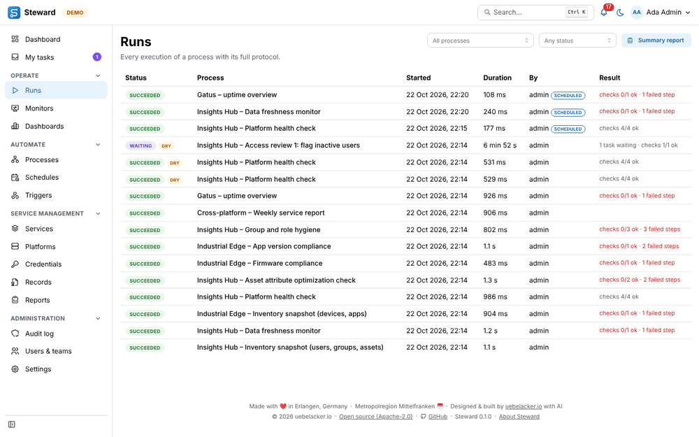
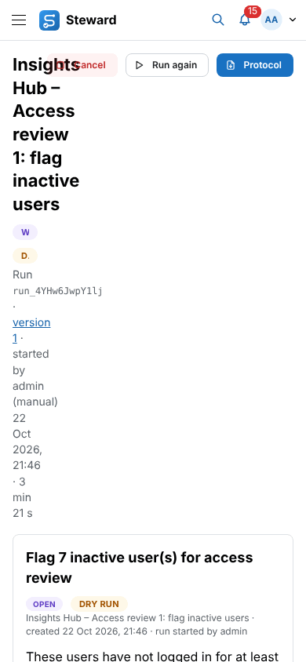
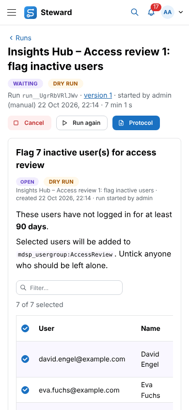
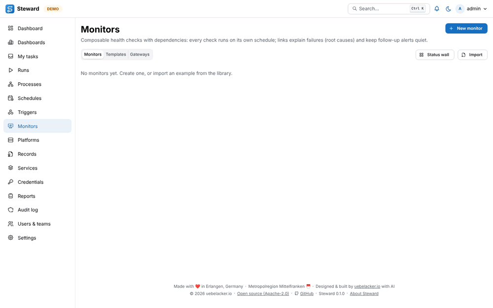
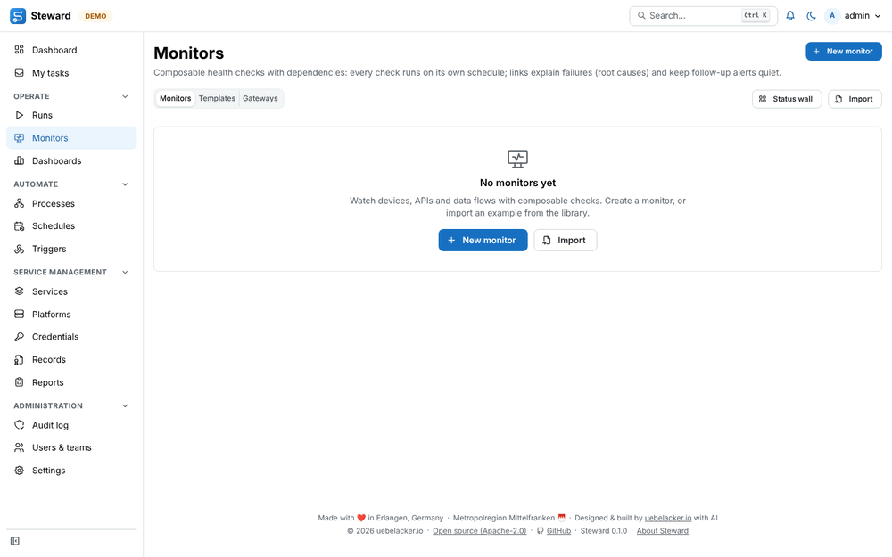
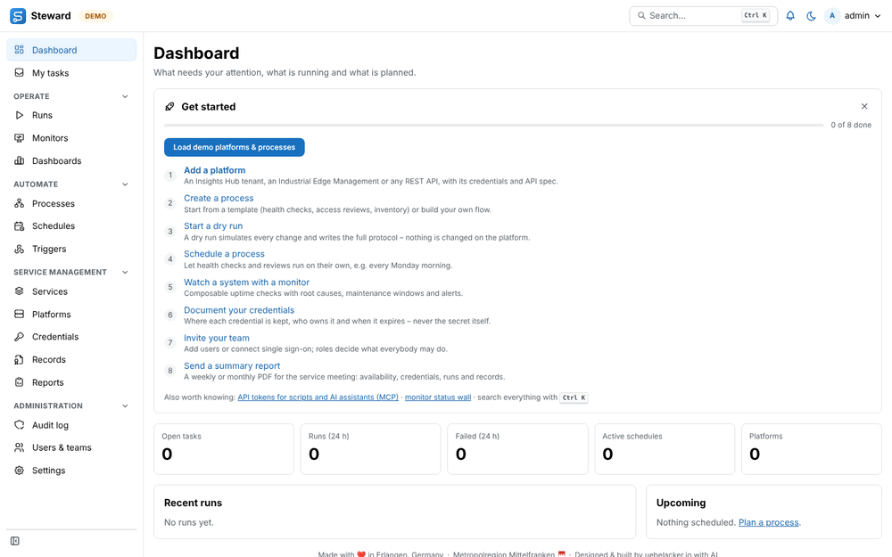

# UI/UX review

A review of the Steward web UI in October 2026, what was changed because of it, and what is left to do.

## How the review was done

- The app ran in demo mode (`SM_DEMO=1`) with the demo data plus extra runs, an open approval task, three credentials (OK, due soon, overdue), a service, three records, a report schedule and a webhook trigger. A second, empty installation showed the first-run experience and the empty states.
- Every main page, the detail pages, the command palette and the _New record_ dialog were captured with Playwright at 1440 px and 390 px, in light and dark mode, and looked at one by one.
- The pages were checked against Nielsen's 10 usability heuristics, WCAG 2.2 AA and the usual Mantine/Material conventions (page header with the primary action on the right, empty states with guidance and an action, breadcrumbs on detail pages, one colour vocabulary for status).

Severity: **High** – blocks or seriously hinders a task, or fails WCAG AA. **Medium** – slows people down or confuses them. **Low** – polish.

## Findings

| #   | Severity | Page                                                                                                                                    | Issue                                                                                                                                                                                                                | Recommendation                                                                                                             | Status       |
| --- | -------- | --------------------------------------------------------------------------------------------------------------------------------------- | -------------------------------------------------------------------------------------------------------------------------------------------------------------------------------------------------------------------- | -------------------------------------------------------------------------------------------------------------------------- | ------------ |
| 1   | High     | Run detail, Credentials, every page with a long title (390 px)                                                                          | The page header squeezed the title into a column of about 80 px. On a run the _Cancel_ button covered the title and the status badges were cut to "W" and "D." (WCAG 1.4.10 Reflow).                                 | Let the actions wrap below the title on narrow screens.                                                                    | Fixed        |
| 2   | High     | Runs list, recent runs on the start page, start-page tiles, process, platform and dashboard cards, "last run" on Schedules and Triggers | Clickable rows and cards only had a mouse `onClick`. The runs list had no link at all, so a keyboard user could not open a run from it (WCAG 2.1.1 Keyboard).                                                        | Put a real link in every clickable row or card; keep the larger click target for the mouse.                                | Fixed        |
| 3   | Medium   | Sidebar                                                                                                                                 | 16 entries in one flat list, daily pages mixed with administration, no landmark name. On a 900 px high screen _Settings_ needed scrolling. (Heuristic 6: recognition rather than recall, 8: minimalist design.)      | Group into sections, order by frequency of use, allow folding sections and the whole sidebar.                              | Fixed        |
| 4   | Medium   | Run, record, record editor, record types, monitor, monitor editor, service, dashboard, process editor, system status                    | No way back to the list other than the sidebar or the browser; only the platform page had "← Platforms" (Heuristic 3: user control, 7: efficiency).                                                                  | Breadcrumb above the title of every detail page.                                                                           | Fixed        |
| 5   | Medium   | Runs, Schedules, Triggers, Monitors, Records, Services, Credentials, Reports, My tasks                                                  | Empty lists showed one grey sentence and no action; Platforms, Processes and Dashboards each had a different design (Heuristic 4: consistency, 10: help).                                                            | One empty-state component: icon, title, one or two sentences of guidance, the primary action for users who may use it.     | Fixed        |
| 6   | Medium   | All list pages                                                                                                                          | While loading, most lists showed nothing; when the request failed, the page stayed blank (Heuristic 1: visibility of system status, 9: recover from errors).                                                         | Skeleton rows while loading, an error message with _Try again_.                                                            | Fixed        |
| 7   | Medium   | Command palette                                                                                                                         | Covered pages, processes, dashboards and platforms, but not monitors, services, records or credentials; the only "create" action was _New process_; status wall, record types, system status and About were missing. | Add the newer entities as search results, add "New …" actions that open the create dialogs, add the missing pages.         | Fixed        |
| 8   | Medium   | Start page                                                                                                                              | The 3-step "Get started" hint disappeared as soon as one platform existed. Monitors, credentials, reports, users and the API/MCP had no first-run guidance (Heuristic 10).                                           | A checklist for administrators that tracks real progress and links each step to its create dialog.                         | Fixed        |
| 9   | Medium   | Credentials (390 px)                                                                                                                    | Seven filter fields filled the whole first screen before the first entry.                                                                                                                                            | Fold filters behind a _Filters_ button on phones, with the number of active filters.                                       | Fixed        |
| 10  | Medium   | 24 places (delete, archive, rotate, revoke, lock vault …)                                                                               | Destructive actions use the browser's `confirm()`: unthemed, no red destructive button, no room for consequences, inconsistent with the Mantine dialogs used elsewhere.                                              | A `confirmDanger()` helper on `@mantine/modals`; migrate the call sites and their UI tests.                                | Fixed        |
| 11  | Medium   | Runs and Records tables (390 px)                                                                                                        | Six columns; process names wrap word by word and the table scrolls sideways. Services already switches to cards on phones.                                                                                           | Card list on narrow screens, like Services.                                                                                | Fixed        |
| 12  | Medium   | Create dialogs (e.g. _New record_)                                                                                                      | The primary button stays disabled until the form is valid without saying what is missing (Heuristic 9).                                                                                                              | Keep the button enabled and show inline errors on submit, or a hint next to the disabled button.                           | Partly fixed |
| 13  | Medium   | Lists in general                                                                                                                        | No sorting anywhere; Runs stops at 200 entries without telling; filters sit in the header on Runs but below it on Records and Credentials.                                                                           | A shared table with sortable columns, a "showing 200 of N / load more" footer and one filter bar position.                 | Fixed        |
| 14  | Low      | Start page, run detail                                                                                                                  | Failed-check severities were loud filled badges on the start page and plain text in the run's checks table.                                                                                                          | One `SeverityBadge` in the light variant.                                                                                  | Fixed        |
| 15  | Low      | Runs, monitors, credentials, checks                                                                                                     | Four separate colour maps. The meaning was mostly the same, but nothing kept it that way.                                                                                                                            | One documented vocabulary (`TONE` in `web/src/components/common.tsx`).                                                     | Fixed        |
| 16  | Low      | Narrow tables                                                                                                                           | Run status badges were cut to "SU…".                                                                                                                                                                                 | Badges never shrink below their text.                                                                                      | Fixed        |
| 17  | Low      | Credentials                                                                                                                             | Empty filter selects without a placeholder, unlike Records ("All types").                                                                                                                                            | "All types", "All statuses", "All platforms".                                                                              | Fixed        |
| 18  | Low      | Unknown address                                                                                                                         | Showed the bare text "Page not found".                                                                                                                                                                               | Empty state with a link to the start page.                                                                                 | Fixed        |
| 19  | Low      | Monitors vs. everything else                                                                                                            | Monitor status badges are filled, all other status badges are light.                                                                                                                                                 | Keep it on purpose (a monitor's state is the main signal of the page) but write the rule down; see "Status colours" below. | Documented   |
| 20  | Low      | Record detail (decision records)                                                                                                        | Template sections without content show an empty bullet ("•") and "1.".                                                                                                                                               | Hide empty list items in the preview, or show the template hint in grey.                                                   | Fixed        |
| 21  | Low      | Start page                                                                                                                              | No tiles for monitors that are down or credentials that are due; on phones the five tiles leave one alone in the last row.                                                                                           | Add "Monitors down" and "Credentials due" tiles (six tiles fill 2 and 3 columns).                                          | Fixed        |
| 22  | Low      | Keyboard                                                                                                                                | Ctrl/⌘ K is the only shortcut and nothing lists it except the search button.                                                                                                                                         | A `?` help dialog with shortcuts; optional `g r` (runs), `g m` (monitors) …                                                | Fixed        |
| 23  | Low      | MCP, public API, IoT gateway                                                                                                            | Only reachable through Profile → API tokens, Settings and the Monitors → Gateways tab.                                                                                                                               | Linked from the checklist now; later a _Help / What's new_ menu in the header.                                             | Fixed        |
| 24  | Low      | Every page                                                                                                                              | The two-line footer takes space on every page, also on phones.                                                                                                                                                       | One line, or only on the About page and the sign-in page.                                                                  | Fixed        |
| 25  | Low      | Record and monitor detail                                                                                                               | The page actions (Edit, Propose, Check now) sit in a row below the header, on other detail pages they sit on the right of the title.                                                                                 | Move them into the header's `actions` (they wrap on phones now).                                                           | Fixed        |

Checked without findings: dark mode on all captured pages (contrast holds, the axe checks are clean), the user menu, the notification centre, the run dialog, Settings and Users & teams.

## What was implemented

### Grouped, foldable sidebar

The sidebar has sections, ordered by how often a service team needs them:

| Section            | Pages                                              |
| ------------------ | -------------------------------------------------- |
| (top)              | Dashboard, My tasks                                |
| Operate            | Runs, Monitors, Dashboards                         |
| Automate           | Processes, Schedules, Triggers                     |
| Service management | Services, Platforms, Credentials, Records, Reports |
| Administration     | Audit log, Users & teams, Settings                 |

- Click a section heading to fold it. The browser remembers it. A folded section still opens when it holds the current page.
- The button at the bottom folds the whole sidebar to icons (desktop only; tooltips name the pages; the open-task count shows as a dot). The phone drawer always shows the full sidebar.
- The sidebar is the landmark _Main navigation_. Entries are a little more compact, so the whole sidebar fits on a 900 px high screen.
- Pages without the right are left out, as before; a section without pages disappears.
- Code: `web/src/components/AppNav.tsx` (`NAV_GROUPS`).

Before: [nav-before.png](images/ux/nav-before.png).

### Page header, breadcrumbs, 404

- `PageHeader` takes `back` (a sidebar page key, a link, or several). Detail pages show it as a _Breadcrumb_ navigation above the title: Run, record, record editor (Records › CR-2026-0001), record types, monitor, monitor editor, service, dashboard, process editor, platform, system status.
- The title keeps at least 18 rem; the actions wrap below it on narrow screens instead of covering it.

| Before                                                      | After                                                     |
| ----------------------------------------------------------- | --------------------------------------------------------- |
|  |  |

### Empty, loading and error states

- `EmptyState`: icon, title, guidance, the primary action for users who may use it (`compact` inside a card). The action has its own label ("Add your first entry"), so screen readers do not meet two buttons with the header's name. Used on Runs, My tasks, Schedules, Triggers, Monitors, Records, Services, Credentials, Reports, Processes, Dashboards, Platforms and for unknown addresses.
- Filtered lists without matches keep a short "No … match the filter" line, so people do not mistake a filter for an empty register.
- `QueryState`: skeleton rows while a list loads, an error message with _Try again_ when it fails.

| Before                                                  | After                                                 |
| ------------------------------------------------------- | ----------------------------------------------------- |
|  |  |

### Getting-started checklist

Administrators see a checklist on the start page until every step is done or they hide it (remembered per browser): add a platform, create a process, start a dry run, schedule a process, watch a system with a monitor, document credentials, invite the team, send a summary report. Each step links to the page or straight to its create dialog. A line below points to API tokens for scripts and AI assistants (MCP), the monitor status wall and Ctrl/⌘ K. On an empty demo installation the _Load demo platforms & processes_ button sits inside the checklist.

`GET /api/dashboard` returns the counts (`setup`) only to administrators; other users still see the simple 3-step hint while there is no platform.

### Command palette

- Pages show their sidebar section; new pages: monitor status wall, record types, system status (auditors and administrators), About.
- New actions: _New monitor_, _New record_, _New credential entry_, _New service_, _New schedule_ (each only for users who may create it). They open the page with `?new=1`; the page opens its create dialog and removes the parameter.
- New search results: monitors, services, records (number and title) and credential entries (opens the entry).

### Keyboard access

Runs, process, platform and dashboard names, the start-page tiles and the "last run" cells are real links now, so every list can be used with the keyboard.

### Status colours

One colour vocabulary, `TONE` in `web/src/components/common.tsx`, used by runs, tasks, monitors, credentials and check severities (`SeverityBadge`). The label always names the status, so colour is never the only signal.

| Tone      | Colour | Used for                                  |
| --------- | ------ | ----------------------------------------- |
| ok        | green  | succeeded, completed, up, OK              |
| bad       | red    | failed, down, expired, error              |
| attention | orange | interrupted, blocked, overdue, warning    |
| soon      | yellow | degraded, due soon, dry run               |
| active    | blue   | running, maintenance                      |
| person    | violet | waiting for a decision, open task         |
| neutral   | gray   | queued, cancelled, skipped, unknown, info |

Variants: status of a list entry or a lifecycle (runs, tasks, credentials, records) – `light`; a monitor's current state, the main signal on monitor pages – `filled`; a draft or a neutral tag – `outline`. Record statuses keep their own map in `shared/src/records.ts` (also used by the PDFs).

### Tests

- `e2e/navigation.spec.ts`: sections and folding (remembered, opens on its own pages), the icon-only sidebar (with an axe check), breadcrumbs, the 404 page, palette pages, monitor search and "New record", a viewer's sections and actions, the checklist on an empty installation (progress, a step opening its dialog, hiding) and the empty states of nine pages.
- `e2e/mobile.spec.ts`: filters folded on phones; Records, Services and Triggers added to the "no horizontal scroll" checks.
- `server/test/dashboard-setup.test.ts`: the setup counts, and that only administrators get them.
- `server/test/dashboard-attention.test.ts`: which tiles administrators, auditors, operators and viewers get, and that monitors, credentials and findings the user may not see are not counted; vendor tickets and the run filter by start time.

## Backlog, implemented

The backlog of this review was implemented in a second round (all P1–P3 items).

### Confirmation dialog (finding 10)

- `confirmDanger()` in `web/src/components/confirm.tsx`, on `@mantine/modals` (the `ModalsProvider` sits in `main.tsx`). It returns a promise: `if (!(await confirmDanger({ action: 'delete', message }))) return;`.
- Each action has a title and a button label in `common:confirm` (delete, archive, remove, revoke, rotate, reset, lock vault, discard, clean up, confirm). The body holds the existing question with its consequence. The button is red; `confirmDialog({ …, danger: false })` is the neutral variant (confirming a platform's connection settings).
- Focus starts on _Cancel_, so Enter never confirms by accident; Escape and the close button cancel.
- All 30 `window.confirm()` calls use it. The UI tests click the dialog's button (`confirmDialog()` in `e2e/support/helpers.ts`) instead of accepting a browser dialog.

### Lists: one table component (findings 11, 13)

- `DataTable` in `web/src/components/DataTable.tsx`: column definitions, sortable headers (a button in the header, `aria-sort`; ascending → descending → the list's own order; client side over the loaded rows, empty values last, status columns sort by severity or lifecycle), rows that open their entry, and a card list up to 48 em with a _Sort by_ menu.
- `ListFooter`: "Showing the first 200 entries" with _Load more_ while the server has more, otherwise the number of entries.
- Migrated: Runs (also the start page's recent runs), Records, Credentials, Tickets, Monitors and Access changes. Runs and Credentials had no phone layout before; the others keep their cards.
- Runs page through the existing `before` cursor of `GET /api/runs` (200 per page, `?limit=` for a smaller page). The server now fills a page even when many runs belong to processes the user may not see (it used to stop after three times the limit, so the page could end early). Records ask for one more than shown and raise the limit by 500 with _Load more_.
- Filters sit below the page header on every list. Runs moved its filters there (with labels) and folds them behind _Filters_ on phones like Records and Credentials. `?status=` and `?processId=` preset the run filters, `?status=` the credential and monitor filters.

### Inline validation (finding 12)

`useFieldErrors()` in `web/src/components/common.tsx`: the primary button stays enabled; on submit the missing or wrong fields show their message ("Required") and the first one gets the focus. Used in _New record_, _New service_ / edit service, _New schedule_, _Add user_, the Git sync source, the ticket reference form, the credential editor (name, owner addresses, linked items) and the monitor gateway dialog. Forms set `noValidate`, so the browser's own bubbles do not get in the way. The error colour is darker (red 9 in light, red 4 in dark mode) so it reaches 4.5:1.

Still disabled until valid (left as they are: a single obvious field or a security flow): the summary report dialog, record actions that need a comment, the PDF dialog, the connector type dialog, the SSO provider editor, the vault passphrase change and the sign-in forms.

### Loading states on detail pages (backlog 4)

`DetailState`: a skeleton of breadcrumb, title and content while the entry loads; when it fails, the breadcrumb back, the translated reason and _Try again_. Used on run, monitor, record, record editor, service, ticket, dashboard and platform pages.

### Start page tiles (finding 21)

The tiles show what needs the user's attention, not an inventory (the _Platforms_ and _Active schedules_ tiles are gone; upcoming schedules stay in the _Upcoming_ list). In this order, each a link to the matching filtered list:

| Tile                        | Counts                                                                                  | Subtitle                  | Opens                                         |
| --------------------------- | --------------------------------------------------------------------------------------- | ------------------------- | --------------------------------------------- |
| Waiting for you             | Open approvals and decisions the user may decide                                        | Approvals and decisions   | `/tasks` (My tasks)                           |
| Failed runs (24 h)          | Failed runs of visible processes started in the last 24 hours                           | of N runs                 | `/runs?status=failed&within=24h`              |
| Monitors down               | Down monitors the user may view (enabled, no templates)                                 | N degraded                | `/monitors?status=down,degraded`              |
| Credentials due             | Expired, overdue and due-soon entries the user may see                                  | N overdue · N due soon    | `/credentials?status=expired,overdue,dueSoon` |
| Undocumented access changes | Open findings of the access reconciliation checks the user may read                     | Open findings to document | `/compliance/reconciliation?findings=open`    |
| Waiting on vendors          | Open ticket references with status _waiting for vendor_, or _open_ with a vendor source | oldest N days             | `/tickets?waiting=vendor`                     |

- **Counted on the server** (`attention` in `GET /api/dashboard`) with the feature's own permission rules, so the start page never counts what the user may not open. A kind the user has no right to at all is left out of the response, and the tile is not shown (not a 0): no monitor tile without a visible monitor (unless the user may create them), no credential tile for a viewer who owns no entry, no findings tile without a readable check (administrators and auditors always get it). Ticket references are readable by everyone.
- **Tone**: a tile that needs attention uses the status colours (`TONE`): violet for decisions, red for failures, expiry and down monitors, orange for overdue credentials and open findings, yellow for degraded monitors, entries due soon and vendor tickets – on the number, its icon and the left edge. A zero is calm: a green 0 with a check icon and _All quiet_.
- **Layout**: the grid adapts to the number of tiles so no row is left half empty – six tiles 2 × 3 on phones and tablets, 3 × 2 from 992 px; four 2 × 2 (one row on wide screens); five tiles in two columns let the last one span the row.
- **Accessibility**: the tiles are a list of links in the tab order; each link's name is "label: number – subtitle" (e.g. _Failed runs (24 h): 2 – of 14 runs_), so the visible label starts the name. Colour is never the only signal.
- **Filtered lists**: Runs got a _Started_ filter (last 24 hours, last 7 days; `?within=24h`, API `since`); the monitor status buttons switch several statuses (`?status=down,degraded`); Tickets take `?waiting=vendor` (API `waitingOn=vendor`) and Access reconciliation `?findings=open` (only checks with open findings), both shown as a removable filter chip.

### Keyboard shortcuts (finding 22)

`?` opens the shortcut list; `g` then `d` (dashboard), `t` (my tasks), `r` (runs), `m` (monitors) or `p` (processes) opens the page. Shortcuts are ignored while the focus is in a text field, an editor, a dialog, a menu or the process canvas, and with Ctrl, ⌘ or Alt held. Code: `web/src/components/HelpMenu.tsx`.

### Help menu (finding 23)

A _Help_ button in the header: _What's new_ (a short, curated list in the locale files, `nav:help.news`, with a link to the full change log), _Keyboard shortcuts_, the _Getting-started checklist_ for administrators (`/?checklist=1` shows it again even when it was hidden or is complete), the documentation on GitHub (user guide, installation, MCP, public API, monitor gateways, all docs) and _About_.

### Smaller items (findings 20, 24, 25)

- Record previews leave out empty list items (a template's "- " or "1. "); task items stay. Only the renderer (`MarkdownView`) changed; the shared parser's output is the same.
- The footer stays on every page with all its content, but in one compact line (11 px) where it fits and smaller (10 px) and wrapped on phones.
- Record and monitor detail pages show their actions (Edit, Propose, Check now, …) in the page header like the other detail pages.

### Tests

`e2e/ux.spec.ts`: the confirmation flow (focus on Cancel, Escape, Cancel, Delete, axe), sorting and _Load more_ on Runs, filters from the URL, the start page tiles (order, names, links, keyboard, axe, the ticket filter they open, the monitor status filter, the runs period), a viewer's quiet day (green zeros, no tiles without the right) and two balanced columns at 390 px, the shortcut dialog and `g` shortcuts (also that typing in a field is not taken as a shortcut), the Help menu, inline validation (light and dark axe check), the detail skeleton and – on the phone project – run and credential cards without horizontal scroll and the compact footer. `server/test/runs-paging.test.ts`: paging with `before` when most runs are hidden.

## Backlog

Nothing left from this review. Ideas for later:

1. Remember the sort order of a list per browser.
2. Server-side sorting and totals ("200 of 1,240") for the run list; today the count is only known for lists that are loaded completely.
3. Inline validation for the remaining dialogs listed above.
