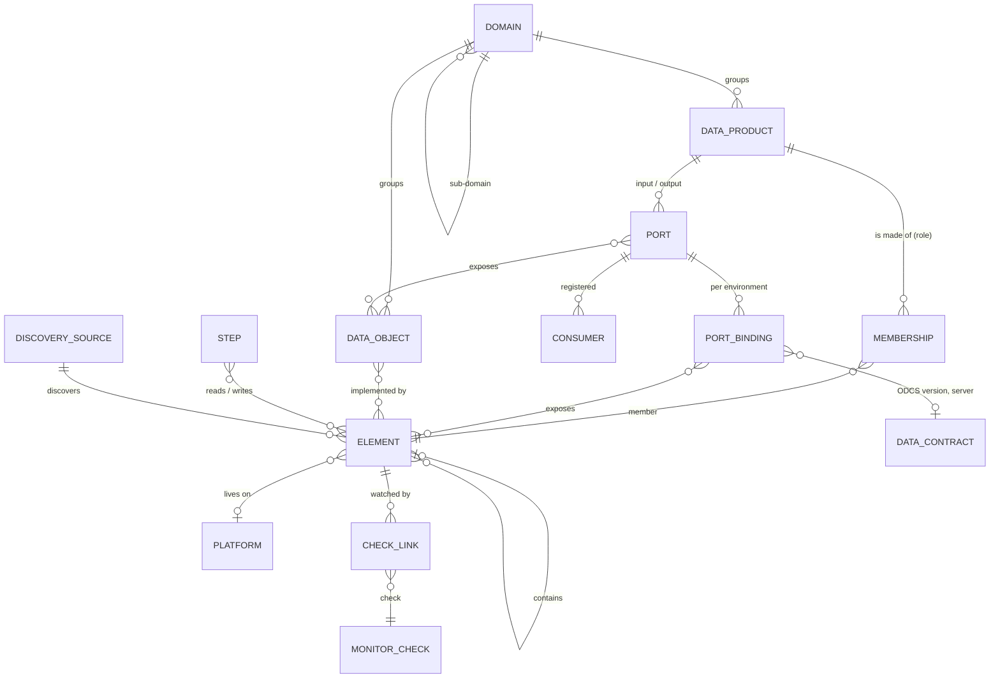
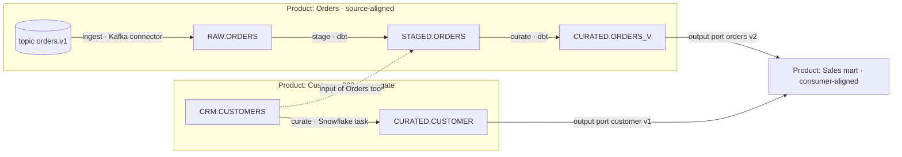

# 0036. The data products module: data objects, products, elements, ports and pipelines

- **Status:** Accepted – the owner said _"go ahead"_ and accepted every recommendation under _Owner decisions_ (2026-11-12), with the additions of the same day (data objects, ratings of products, environments and the list in part 17); built in 0.22.0 (phase 1, see _Built in 0.22.0_) – phase 2 to come
- **Date:** 2026-11-12
- **Since:** 0.22.0 (phase 1, see _Phases_); builds on [ADR 0016](0016-module-registry.md) (module registry), [0019](0019-data-collections.md) (data collections – layers, sinks, lineage), [0026](0026-service-cost-planning.md) and [0032](0032-cost-attribution-platform-plans.md) (costs, attribution, no chargeback), [0033](0033-one-access-model.md) and [0034](0034-module-access.md) (owning teams, shares, module access), and [0035](0035-price-books-and-calculators.md) (price books and estimates, proposed)

## Context

The owner wants Steward to document **data platforms and data mesh work from the IT service team's side**: the data products a domain offers, what they are made of on Snowflake, Kafka/Confluent, SQL databases, APIs and file stores, how data flows through them, whether they are healthy, what they cost, who uses them and who may – built overnight after this record, with good performance, security, pictures and UI. On the same day the owner added: **data objects** (the business data itself, rated like applications), **ratings and a lifecycle for products**, **environments** and a list of further parts (part 17).

### What Steward has

- **Data contracts** ([DATA-CONTRACTS.md](../DATA-CONTRACTS.md), module `dataContracts`): ODCS v3 contracts with versions, a breaking-change comparison, an optional change-record rule, links (database tables, datasets, applications, systems, API specifications, the database platform of a server), drafts from schema snapshots, datasets and OpenAPI responses, tests through the datacontract CLI for PostgreSQL, MySQL and SQL Server servers (Snowflake, Kafka and API servers are _not yet_ mapped), SQL quality rules held to Steward's statement check, Steward's own findings (owner, not tested, columns that no longer match), the monitor check `data-contract`, a scorecard part and a report section. Contracts have owning teams; ODCS v3 already has `schema` objects for tables, topics and API responses, `servers` with an `environment`, `slaProperties`, quality rules with a `dimension`, and `classification` on properties.
- **Platforms** ([PLATFORMS.md](../PLATFORMS.md)): **Snowflake** through the SQL API with key-pair sign-in and a read-only role ([SNOWFLAKE.md](../SNOWFLAKE.md)) – a _Snowflake database_ application component with its tables, size, last change, failed tasks and warehouse credits; the `snowflake` monitor check (`freshness` from `<db>.INFORMATION_SCHEMA.TABLES`, `tasks`, `credits`); access reviews from grants; costs from `ORGANIZATION_USAGE`. **Kafka** ([KAFKA.md](../KAFKA.md)): _Kafka topic_ components (settings, end offsets and the newest message's time, consumer groups and lag, the subject `<topic>-value` and its version), _Add topics by prefix_ with _Keep in sync_, the `kafka` check (`messagesWithinMinutes`, `maxLag`, `schemaVersion`), Kafka Connect and Debezium readouts whose topics link to topic components. **Confluent Cloud** ([CONFLUENT.md](../CONFLUENT.md)): clusters, managed connectors, Schema Registry subjects, API keys, role bindings, costs per cluster and connector. **Database platforms** ([DATABASES.md](../DATABASES.md), [ADR 0008](0008-database-platforms.md)): read-only SQL on PostgreSQL, MariaDB/MySQL and SQL Server, **schema snapshots** with breaking changes, a tbls import, the `db-schema` check. Platforms also carry **OpenAPI descriptions** (the MCP platform gateway, the contract link _API specification_).
- **The catalogue** ([APPLICATIONS.md](../APPLICATIONS.md)): services → applications (with **components** of a short fixed type list, among them _Kafka topic_ and _Snowflake database_ at **database** granularity) → systems; **environments** (_Settings → Environments_: an ordered list with a production flag, offered on platforms, components and _runs on_ links); **CIA ratings** of applications on the instance's **CIA scale** with justification, re-rating when the scale changes, and the maximum principle for services; criticality; **link kinds** through which documents, records, ticket references and firewall changes name items.
- **Monitors** ([MONITORS.md](../MONITORS.md), [ADR 0021](0021-monitor-states.md)): a graph of checks with **soft links** that turn a failing child of a failing parent into _likely caused by_ the topmost failing ancestor – **root causes**; statuses up, degraded, down, unknown, blocked, maintenance, off; hourly uptime samples; checks run with the **owner's use right**; the pattern **_Create monitor_ from a mapping** – a disabled draft monitor whose checks are linked to the items they cover ([PLANT.md – Insights Hub mapping](../PLANT.md#insights-hub-mapping)).
- **Costs** ([COSTS.md](../COSTS.md)): FOCUS cost lines from AWS, Snowflake, Confluent, AI gateways and FOCUS files, mapped to a platform, a component and an application; service and team rollups; **attribution** of contracts and plan lines to applications and systems, platforms with their own plans, and **no chargeback** ([ADR 0026](0026-service-cost-planning.md), [ADR 0032](0032-cost-attribution-platform-plans.md) option 2). Snowflake's lines are per account and service type, Confluent's per cluster, connector and product – nothing in the bill names a table or a topic. [ADR 0035](0035-price-books-and-calculators.md) (proposed) adds price books, calculators and estimates, with _data products as targets_ listed under _later_.
- **The plant registry** ([PLANT.md](../PLANT.md)): the **three layers** of [ADR 0019](0019-data-collections.md) – the canonical data point, the asset's binding, the collector's item – and **sinks** with ordered transformation steps (documentation, never run), a **collector** that is a Steward application, platform or process or a job named in text, data paths that **continue in** each other across systems, the **lineage** and **data flow** pictures (React Flow with the shared `layeredLayout` and `compoundLayout`, a table for every picture, focusable nodes, reduced motion, SVG/PNG export, _counted, not named_), the Insights Hub mapping with _Check mapping_ and draft monitors, a YAML format with a JSON Schema, and **proposals from assistants** that a person applies.
- **MCP** ([MCP.md](../MCP.md)): read tools as the token owner, team scope, paged; proposals that wait under _AI requests_ and are applied by a person; tool output is data, not instructions.
- **Access** ([ADR 0033](0033-one-access-model.md), [ADR 0034](0034-module-access.md), both accepted, not built): owning teams as scope, shares, the `access.grant` step-up for widening, module access and the module roles viewer, contributor, manager. On `main` today: owning teams (`resource_teams`), the module switch, team scope rules.
- **Suppliers** ([SUPPLIERS.md](../SUPPLIERS.md)): whether a contract processes personal data, and its **data processing agreement** (in place or missing). Steward marks personal data on suppliers only – services and applications have no such mark.
- **The semantic model** ([SEMANTIC-MODEL.md](../SEMANTIC-MODEL.md)) describes **Steward's own** REST resources in the Apache Ossie format, the same for every token; the **glossary** ([GLOSSARY.md](../GLOSSARY.md)) is Steward's own vocabulary. Neither is a business glossary of a company's data – the owner's hint to reuse them is answered in part 2.

### What is missing

Nothing describes a **data product** as a unit. A topic or a database hangs off an application as a component; there is no table, view, dynamic table, stream, task or topic bundle as an entry of its own; a contract floats beside what it describes; lineage exists only inside the plant registry; a health picture of a pipeline means building monitors by hand; a cost per product cannot be read except for a whole account; nobody records which business data – customers, orders, machine measurements – lives where, how sensitive it is and who answers for it.

### Standards and practice

- **Data mesh** (Zhamak Dehghani): domain ownership, data as a product, a self-serve platform, federated computational governance; a product is _code, data, metadata and infrastructure_ with **input ports**, **output ports** and discovery and observability as its interfaces; products are **source-aligned**, **aggregate** or **consumer-aligned**.
- **Bitol** (Linux Foundation AI & Data): the **Open Data Contract Standard** (ODCS v3, used since 0.10) and the **Open Data Product Standard** (ODPS v1.0.0): `kind: DataProduct`, `id`, `name`, `version`, `status` (proposed, draft, active, deprecated, retired), `domain`, `tenant`, `description`, `inputPorts` and `outputPorts` that name an ODCS `contractId`, `managementPorts`, `support`, `team`, `tags`, `customProperties`, `authoritativeDefinitions`. Not to be confused with the _Open Data Product Specification_ of opendataproducts.org (pricing plans, data access, marketplace terms).
- **OpenLineage** (LF AI & Data): run events with a job and input and output datasets named by a **namespace** (`snowflake://<org>-<account>`, `kafka://<bootstrap host>:<port>`, `postgres://<host>:<port>`) and a **name** (`DB.SCHEMA.TABLE`, the topic).
- **ISO/IEC 25012** (data quality model): accuracy, completeness, consistency, credibility, currentness; accessibility, compliance, confidentiality, efficiency, precision, traceability, understandability; availability, portability, recoverability.
- **GDPR** Art. 5 (storage limitation), 6 (legal basis), 9 (special categories), 28 (processors), 30 (records of processing activities); the roles **data owner**, **data steward** and **technical custodian** of data governance practice (DAMA-DMBOK).
- **Catalogues** – DataHub, OpenMetadata, Collibra, Microsoft Purview, Unity Catalog – each hold their own model of datasets, lineage, glossary terms and domains (alternatives 1 and 2).

## Decision

**A module _Data products_ (`dataProducts`, preview, off by default, restrictable) with its own thin model: _data objects_ say what the business data is, how sensitive and whose; _elements_ are concrete things on a platform, discovered or entered, in a catalogue of their own; a _data product_ belongs to a domain, has a type, a rating, a lifecycle and owners, and is made of elements – many to many, with a role per membership – in one or more environments; its _ports_ expose elements and data objects, each output port optionally under an ODCS contract, with registered consumers and objectives; _steps_ document how data moves between elements (the three layers of ADR 0019, again documentation, never run); _checks_ are monitor checks linked to elements, so a product gets a monitor with root causes along its pipeline; _costs_ are attributed from the cost lines Steward reads, shared lines split by a declared rule – showback, never chargeback. Steward keeps links to external catalogues instead of becoming one; ODPS and ODCS are the exchange formats; discovery reads metadata only, with the platform's read-only identity.**

Code (planned): `shared/src/dataProducts.ts` (types, kinds, limits, the rating floor and maturity as pure functions), `shared/src/dataProductGraph.ts` (graph building and collapsing for the pictures); `server/src/dataproducts/` – `store.ts`, `service.ts`, `access.ts`, `ratings.ts`, `routes.ts`, `api-schemas.ts`, `links.ts`, `discovery/` (`snowflake.ts`, `kafka.ts`, `schema-registry.ts`, `dbschema.ts`, `job.ts`), `checks/` (`freshness.ts`, `schema.ts`), `health.ts`, `monitor-draft.ts`, `costs.ts`, `scorecard.ts`, `notices.ts`, `views.ts`, `format.ts`, `import.ts`, `export.ts`, `odps.ts`, `api-v1.ts`, `mcp.ts`, `demo.ts`; migrations `server/src/migrations/dataproducts.ts`; feature manifest `server/src/features/dataproducts.ts`; web `web/src/pages/dataproducts/` and `web/src/components/dataproducts/`; docs `docs/DATA-PRODUCTS.md` and the JSON Schema `docs/data-products/data-products-1.schema.json`.

### 1. The model

| Entry                | What it is                                                                                                                                                                       | Kept in                                     |
| -------------------- | -------------------------------------------------------------------------------------------------------------------------------------------------------------------------------- | ------------------------------------------- |
| **Domain**           | A business domain (_Sales_), optionally a sub-domain (_Sales → Orders_, at most two levels), with owners and owning teams                                                        | `dp_domains`                                |
| **Data object**      | What the data **is**: _Customer_, _Order_, _Machine measurement_ – definition, rating, classification, personal data, legal basis, retention, owner, steward, custodian (part 2) | `dp_objects`                                |
| **Data product**     | What a domain **offers**: type, domain, owners, rating, lifecycle, ports, objectives, docs (part 3)                                                                              | `dp_products`                               |
| **Element**          | A concrete thing on a platform – a table, a topic, an API, a path – in one environment (part 5)                                                                                  | `dp_elements`                               |
| **Membership**       | Element ∈ product with a **role**: input, internal (transformation), output (part 6)                                                                                             | `dp_members`                                |
| **Port**             | A product's interface, environment-independent: name, type, version, lifecycle, objectives (part 7)                                                                              | `dp_ports`                                  |
| **Port binding**     | The port in one environment: its elements, the contract version and server, the objectives that differ                                                                           | `dp_port_bindings`, `dp_port_elements`      |
| **Consumer**         | A registration on an output port: who, purpose, since, agreement (part 7)                                                                                                        | `dp_consumers`                              |
| **Step**             | How data moves: inputs → a runner (a job) → outputs, with transformation notes (part 9)                                                                                          | `dp_steps`, `dp_step_elements`              |
| **Check link**       | An element (or step) watched by a monitor check (part 10)                                                                                                                        | `dp_check_links`                            |
| **Discovery source** | What Steward reads from a platform to fill the catalogue, how often, as whom (part 5)                                                                                            | `dp_discovery_sources`, `dp_discovery_runs` |

**Three layers again** (ADR 0019, reused): the **data object** is the canonical thing (as the profile's data point), the **element** is its concrete binding on a platform in an environment (as the asset's address), the **step** is what a collector does on the way to the next element (as the collection item and its **sink** with transformation steps). A plant sink whose target is an element – an Insights Hub aspect, a Kafka topic, a system path – continues into the data products' lineage (part 9).

_CRM.CUSTOMERS_ is one element, a member of two products (input of both); the mart's input ports name the output ports of the two others, which is what the product map draws.

### 2. Data objects – the data itself

- **A data object** has a key (`customer`), a name, a **definition** (Markdown), synonyms (at most 20), a domain, a **lifecycle** (draft, active, deprecated, retired – as products, part 3), optional **key attributes** (name, description, whether personal – at most 100; a light list, not a schema) and external references (a glossary term in Collibra, Purview or a wiki: a URL and a label).
- **Ratings like applications:** a **CIA rating** on the instance's CIA scale with a justification per dimension, stored and re-rated exactly as application ratings (`dp_ratings`, the same scale, the same _needs re-rating_ when the scale changes – the scale editor counts them); plus a **classification** – _public_, _internal_, _confidential_, _strictly confidential_ (`public`, `internal`, `confidential`, `strictly_confidential`; labels translated, keys fixed).
- **Personal data:** _none_, _personal_ or _special categories_ (GDPR Art. 9); the **categories** (suggested list: identification, contact, employment, financial, location, online identifiers, behaviour, technical device data; free values allowed) and the **special categories** (Art. 9's list: racial or ethnic origin, political opinions, religious or philosophical beliefs, trade union membership, genetic, biometric for identification, health, sex life or sexual orientation; and Art. 10 criminal convictions); the **data subjects** (customers, employees, contacts of suppliers …); the **legal basis** (Art. 6(1)(a)–(f), with a note); **purposes**; the **retention period** (an ISO 8601 duration such as `P10Y`, or text) and the **deletion rule** (text).
- **Regulatory flags:** a managed list (_Settings → Data products → Regulatory flags_; suggested: GDPR, trade secret, export control, SOX, NIS2, product liability) – tags with a meaning, nothing enforced.
- **Roles:** the **data owner** (accountable – decides classification and access; a user), the **data steward** (definitions and quality; users or a team), the **technical custodian** (runs where it is stored; a team or an application's responsible people). They are **responsibility, not rights** – as owners and responsibles in ADR 0033 part 2: reminders, review notices, the Art. 30 view; editing follows the data object's owning teams and shares.
- **Elements implement data objects** (many to many: `dp_object_elements`, with an optional note which part – _only EU customers_). **Products expose data objects** through their output ports (`dp_port_objects`); a port's objects are also derived from what its elements implement, and the port shows both (_declared_, _through elements_). A product **processes** a data object when any of its member elements implements it – the basis of the Art. 30 view (part 17).
- **Field-level personal data** comes from the contract, not from Steward: the ODCS property's `classification` and the Steward convention `customProperties: [{ property: personalData, value: true }]` on a property mark a field; the product's page lists such fields of its output ports' contracts (phase 2).
- **No separate glossary.** Data objects with their definitions, synonyms and key attributes **are** the business glossary of the module; an external glossary is an external reference. The Ossie semantic model stays Steward's self-description; phase 2 adds an **Ossie export of the data objects** (each object a dataset with its key attributes as fields and its relationships), so BI tools and agents read the business vocabulary the same way they read Steward's own.

### 3. Data products

| Field                  | What                                                                                                                                                                             |
| ---------------------- | -------------------------------------------------------------------------------------------------------------------------------------------------------------------------------- |
| Key, name, description | A key unique in the instance (`orders`, used by the file format, Git and ODPS `id`), a name, a description and **purpose** in Markdown, tags (as elsewhere)                      |
| Type                   | **Source-aligned**, **aggregate**, **consumer-aligned** (Dehghani) or not set                                                                                                    |
| Domain                 | A domain or sub-domain                                                                                                                                                           |
| Owners                 | The **product owner** (users) and owning teams (scope, ADR 0033); support: a channel, a URL, hours – ODPS `support`                                                              |
| Rating                 | A **CIA rating** (as data objects), a **criticality** (low, medium, high, critical – as applications) and a **support tier** (1–3: how it is supported, e.g. hours and response) |
| Lifecycle              | **proposed → draft → active → deprecated → retired** (the ODPS statuses), with the dates of each change, a **sunset date** when deprecated, and a **successor** product          |
| Maturity               | **Computed**, never typed (decision 9): 1 _documented_, 2 _observed_, 3 _contracted_, 4 _reliable_, 5 _endorsed_ (phase 2) – the scorecard's verdict (part 13)                   |
| Value                  | A **business value** statement, a value tier (high, medium, low) and optionally an amount per year with its currency – shown beside the attributed costs (part 11), never netted |
| Version                | The product's version (ODPS `version`) – a label; history is the audit trail                                                                                                     |
| Docs, external refs    | Links (a wiki page, a DataHub URN, a repository); documents and records attach through the link kind (part 17)                                                                   |

- **The rating floor.** Per dimension, a product's rating must be **at least the highest rating of the data objects it exposes** (declared on its output ports or implemented by their elements) – the maximum principle of BSI 200-2, as for services. Lower is allowed with a **reason** (the distribution effect: only aggregated data leaves the product), shown as _Below the rating of Customer (C: very high) – reason: …_; without a reason the product page, the list and the scorecard warn (`ratingBelowObjects`). The same for the classification: a product's highest exposed classification is shown on it.
- **Lifecycle rules:** _active_ needs an owner and at least one output port; _deprecated_ needs a sunset date and notifies the registered consumers and the owners of consuming products (part 17); _retired_ asks for confirmation while consumers are registered or consuming products are active, and then shows _retired_ in their input ports. Changing the lifecycle is audited (`dataproduct.lifecycle_changed`). Ports have their own lifecycle (part 7).

### 4. Environments

- **One product, several environments** – Steward's environment list (_Settings → Environments_), as on platforms, components and _runs on_. An **element** belongs to **one environment**: by default its platform's; a discovery source can set it by a **name rule** (`DEV_*` → `dev`, `PROD_*` → `prod` – a prefix or suffix per environment, no patterns) for accounts that hold several stages. Membership, steps and checks follow the elements; **port bindings** say per environment which elements a port exposes, which **contract version and ODCS server** apply (ODCS `servers[].environment`) and which objectives differ.
- **Per environment** the product page shows its elements, ports, health, objectives and costs; _Environment_ above every view, **production first** (the environment flagged production; the default view). A product may exist in prod only, or in dev and test before prod (`dp_product_environments`: the environment, its own state – _planned_, _available_, _withdrawn_ – and the product's monitor there).
- **Alerts and objective reporting are production's** by default: the draft monitor of part 10 is made for one environment (prod preselected); non-production monitors are made on request and marked. The product map, the list, the scorecard and the costs filter by environment.
- **Promotion** dev → test → prod is a **tracked step** (phase 2): _Promote_ proposes the next environment's bindings and memberships from the current one by the name rules (`DEV_DB.SALES.ORDERS` → `PROD_DB.SALES.ORDERS`), shows a preview of what exists there and what is missing, and records the promotion with a **change record** (a document of the CR type) or a **process run** – a template process _Promote a data product_ whose run, with its approval, is the evidence. Steward never deploys anything.

### 5. The element catalogue and discovery

**An element** is one concrete thing: a platform (or none, for _other_), a **kind**, a **qualified name** unique per platform, kind and environment (`SHOP.SALES.ORDERS`, `orders.v1`), a display name, its **parent** (database → schema → table), a **layer** (part 9), a description, its source (_entered_, _discovered_, _imported_), an optional owning **application** (the system of record), and links: an application **component** with the same platform and name (a _Kafka topic_ or _Snowflake database_ component – matched automatically, so the component's readout and the element are one thing seen from two sides), a **plant sink** (part 9), an **API specification** (part 8). Discovered elements also keep a stable **external id** (Snowflake's `TABLE_ID`, Kafka's topic id), an **OpenLineage namespace and name** computed from the platform (phase 2 matches events by them), a **readout** (row count, bytes, last altered, partitions, retention, schema version – separate from the element, `dp_element_readouts`, so a daily read does not rewrite the catalogue) and **missing since** when a read no longer finds it.

| Kind (id)                                                                                           | Platform                              | Discovered from (phase 1)                                                                                                                   |
| --------------------------------------------------------------------------------------------------- | ------------------------------------- | ------------------------------------------------------------------------------------------------------------------------------------------- |
| `snowflake.database`, `snowflake.schema`                                                            | Snowflake                             | the source's scope; `INFORMATION_SCHEMA.SCHEMATA`                                                                                           |
| `snowflake.table`, `snowflake.view` (secure, materialized, external and Iceberg tables as flags)    | Snowflake                             | `<db>.INFORMATION_SCHEMA.TABLES` and `VIEWS` (default), or `SNOWFLAKE.ACCOUNT_USAGE.TABLES` (`TABLE_ID`, `DELETED`) in mode _account usage_ |
| `snowflake.dynamicTable`, `snowflake.stream`, `snowflake.task`, `snowflake.stage`, `snowflake.pipe` | Snowflake                             | `SHOW DYNAMIC TABLES`, `SHOW STREAMS`, `SHOW TASKS`, `SHOW STAGES`, `SHOW PIPES` `IN DATABASE` (metadata columns only)                      |
| `kafka.topic`                                                                                       | Kafka                                 | the cluster's topic list (metadata request; internal topics left out), topic ids; the subject `<topic>-value` from the Schema Registry      |
| `kafka.topicBundle`                                                                                 | Kafka                                 | entered: a **prefix** (as _Keep in sync_) or a list; its topics resolve from the catalogue at read                                          |
| `sql.schema`, `sql.table`, `sql.view`                                                               | PostgreSQL, MariaDB/MySQL, SQL Server | the platform's **latest schema snapshot** – no new connection                                                                               |
| `api.openapi`, `api.asyncapi`, `api.graphql`, `api.endpoint`                                        | any HTTP platform, or none            | entered: a platform's OpenAPI description and operations; an AsyncAPI document or URL; a GraphQL endpoint and query; a URL                  |
| `files.path`                                                                                        | AWS (S3), a system (a share), or none | entered: bucket and prefix, share and path, format                                                                                          |
| `insightsHub.aspect`                                                                                | Insights Hub                          | entered, or from a plant sink's Insights Hub mapping (asset id, aspect)                                                                     |
| `other`                                                                                             | any or none                           | entered, with a free type label (_Power BI dataset_, _Excel extract_)                                                                       |

- **A whole project as one element.** A Snowflake database or schema – a _project_ – is an element; a membership may say **with everything below** (`includeDescendants`), so a product made of `PRD_SDC_OPQ_PBI_DEV.REPORTING` includes its current and future tables without listing them. A topic bundle does the same for topics. Checks and costs can address the project as a unit (part 10).
- **Discovery sources** (`dp_discovery_sources`): a platform, a **scope** (Snowflake: databases and optionally schemas; Kafka: topic prefixes, or all; SQL: the snapshot), **include and exclude prefixes** (plain comparisons, no patterns), the environment rule, the **owning teams** of what it discovers (default: the platform's), a schedule (daily by default; at most hourly) and **_Read now_**. It runs as the person who set it up, with their **use** right on the platform checked again before every run (the rule of _Keep in sync_), and with the platform's identity (or one it names, ADR 0009).
- **Snowflake modes** (decision 12): **information schema** (default) – one database at a time, current, and only objects Steward's role has a privilege on (`USAGE` and `REFERENCES` show metadata, not data); **account usage** – `ACCOUNT_USAGE.TABLES`/`VIEWS` for every database in scope in one statement, up to about 90 minutes behind, needs `IMPORTED PRIVILEGES` (which shows the metadata of the whole account to the role – Steward still keeps only the scope). Results of the SQL API are read **partition by partition** up to the limits.
- **What a read changes:** new elements are added; existing ones get their technical fields (qualified name, kind, flags, external id, parent) and readout; **people's fields** – description, layer, owner application, data objects, links – are never overwritten (the re-import rule of ADR 0019). A Snowflake object with a known `TABLE_ID` under a new name is **renamed**, not replaced (audited); a topic whose id changed is a new element and the old one is _missing_. A missing element stays: in no product, it is removed after 30 days; in a product, it is flagged on the product (_2 elements no longer found on Snowflake (prod)_) and the product's owners are told once (part 17).
- **Entered and imported** elements work exactly like discovered ones; _Import CSV_ on the catalogue (platform, kind, qualified name, environment, layer, description) for platforms Steward cannot read.
- **Not discovered in phase 1:** Confluent Cloud's own catalogue (Stream Catalog), Kafka Connect connectors as elements (they are **runners**, part 9), S3 listings, OpenAPI operations as separate elements (an API element names its operations).

### 6. Membership – many to many, with a role

- `dp_members` (product, element, **role**, note, `includeDescendants`, added by and at). **Roles:** **input port** (consumed – from a source system or another product), **internal** (transformation, staging, intermediate), **output port** (offered). The role is stored, because the owner asked for it and because an element can be internal in one product and output in another; the service keeps it consistent with the ports: an element bound to an output port is an output member, to an input port an input member.
- **The same element in several products** is the point: a shared source table is an input of each product that reads it; its element page lists them (_Part of 3 products_), counting those the reader may not see. Removing an element from one product never touches the others. An element may be a member of a product only in its own environment's bindings; a product's elements of all environments are listed with an environment filter.
- **Adding** needs Edit on the product and **view** on the element; adding gives nobody rights on the element. What readers of the product see of a member element they may not see otherwise is decision 15.

### 7. Ports, contracts, consumers, objectives

- **A port** (`dp_ports`): direction (input, output), name (`orders`), **type** – _table or view_, _topic_, _API_, _file_, _other_ – a **version** (`v2`; two versions are two ports, the older one deprecated), a description, its own **lifecycle** (draft, active, deprecated with a sunset date and a successor port, retired), the **data objects** it exposes (output) or needs (input), and **objectives** (below). Per environment a **binding** names its elements and contract.
- **Output ports and ODCS:** a binding may name a **data contract** (the existing feature: Steward's id), the **version** it is held to (empty: the current one) and the contract's **server** for that environment. The port page shows the contract's status, last test and findings, and _New contract → Start from_ drafts one from the port's elements (database tables from a snapshot exist; Snowflake tables from `INFORMATION_SCHEMA.COLUMNS` and Kafka topics from the Schema Registry's Avro or JSON Schema are new draft sources). A contract may serve several ports; a port has at most one contract per environment.
- **Input ports** say what the product consumes: **another product's output port** (the dependency the product map draws, with that port's version), or a **source** – an element of a system of record, or text (_ERP extract, daily_). An input port on a deprecated output port is flagged (_consumes a deprecated port – sunset 31 Mar 2027_).
- **Consumers** of an output port: **derived** – products whose input ports name it – and **registered** (`dp_consumers`): who (a team, an application, a service, a product, or text), the **purpose**, since when, an **agreement** (a record, a contract, a ticket or a URL), a contact, and an end date. Registrations are what deprecation and breaking changes notify (part 17); _declared against actual_ – who really reads – is phase 2 (Snowflake `ACCESS_HISTORY`, Kafka consumer groups).
- **Objectives (SLO) per output port**, set per port and overridden per binding: **freshness** (the data is at most N minutes old, checked by the element checks of part 10), **availability** (share of time the port's checks are up or degraded, from the monitors' hourly samples, over 30 days), **completeness** (phase 2: volume and quality checks), an **update schedule** (text) and **retention**. Where the contract has `slaProperties` (`latency`, `frequency`, `retention`), the form offers them. An **SLA** – an agreed objective with consequences – is a registered consumer's agreement that names the objectives; Steward reports attainment, it does not enforce.
- **Versioning and deprecation:** a port version change is a new port; deprecating a port notifies its registered consumers and consuming products' owners (phase 1); a **breaking change** of a contract version bound to an output port (the existing comparison) notifies them too (phase 2: a hook in the contract service).
- **Discovery and metadata:** ODPS's `managementPorts` are Steward's own pages and `/api/v1` (part 15); a product page is its discovery port.

### 8. APIs as data products

**Yes, where an API serves data to consumers**: an output port of type **API** bound to an element of kind `api.openapi` (a platform's OpenAPI description and the operations that serve the data – `GET /customers`, `GET /orders/{id}`), `api.asyncapi` (channels with event payloads), `api.graphql` (the queries) or `api.endpoint`, with the version, registered consumers, objectives and a contract whose schema objects describe the responses (contracts already draft from OpenAPI responses). Freshness and availability come from existing checks linked to the element – `freshness` with `source: platform` (a JSONata timestamp from a response), `http`, `platform` – so no new API check is needed.

**An application interface instead** – an application component or a platform's API, not a port – when the API is **behaviour rather than data**: commands and transactions (`POST /orders` places an order), workflow steps, an interface between the components of one application or for its own UI, or an integration whose contract is its operations and their side effects. The rule of thumb on the form: _Would a consumer use it to read the domain's data for their own purpose? Then it is a port._ One API can be both: the port names only its data-serving operations.

### 9. Pipelines and lineage

- **A step** (`dp_steps`): **inputs** and **outputs** (elements, many to many: `dp_step_elements`), a **kind** – _ingest_, _stage_, _transform_, _curate_, _publish_, _replicate_, _other_ –, a **runner**: a Steward **application**, **platform** or **process**, an **element** (a Snowflake task, pipe or dynamic table), a **connector** (a Kafka Connect or Confluent connector by platform and name – its state comes from the existing readouts), or text with a **tool** (suggested: Airflow, Azure Data Factory, dbt, Fivetran, Kafka Connect, Snowflake task, Snowpipe, Spark, AWS Glue, script) –, a schedule (text or cron), a description and ordered **transformation notes** of ADR 0019's kinds (rename, scale, unit, aggregate, filter, enrich or join, compute, format, other). Documentation only: Steward runs no step and evaluates no expression.
- **Layers:** an element has a **layer** from an instance list (_Settings → Data products → Layers_; default _source_, _raw_, _staged_, _curated_, _mart_ – medallion names as labels if a team prefers bronze, silver, gold); the pipeline picture draws layers as columns.
- **Who changes a step:** who may change the products its **output elements** belong to – a step is documented where its result lives, as a data path _comes from_. Inputs the editor may not see stay on save and are counted.
- **Lineage** is the graph of steps across elements, so it crosses products: an element's **upstream** and **downstream** (1–4 steps), a product's **inputs from** and **outputs to** other products. A plant **sink** that names an element (a Kafka topic, an Insights Hub aspect, a system path) links the plant lineage of its data points to the element: the element's upstream shows _Collection Mill data of Milling centre 17 (plant registry)_ where the reader may see the site, else _a data collection you may not see_.
- **Steps from tools** (phase 2): a **dbt manifest** (`manifest.json`: models, sources, seeds, snapshots with `depends_on` and their relations → elements and steps; exposures → registered consumers; `run_results.json` → quality results, part 10) and **OpenLineage** run events (a push endpoint with push tokens, the pattern of FOCUS pushes: datasets matched to elements by namespace and name, jobs to steps by namespace and name, the last run per job as a step's _last run_; events not kept beyond that). Snowflake `ACCOUNT_USAGE.OBJECT_DEPENDENCIES` suggests view → table steps (phase 2). Suggestions are confirmed by a person.
- **Not:** column-level lineage, SQL parsing, a lineage engine (alternative 3).

### 10. Checks and health

- **A new monitor check type `data-element`** (`element` – Steward's id; `mode`; the mode's fields; `failAs`, `warningAs`; `each` for a project or bundle: _every_ table or topic, or _any_). It resolves the element's platform and reads with the monitor **owner's use right** and the platform's (or a named) identity, like every platform check.

| Mode                                              | Snowflake                                                                                                                                                                                                                                                                                                                 | Kafka                                                                                                                                                                     | SQL database                                                               |
| ------------------------------------------------- | ------------------------------------------------------------------------------------------------------------------------------------------------------------------------------------------------------------------------------------------------------------------------------------------------------------------------- | ------------------------------------------------------------------------------------------------------------------------------------------------------------------------- | -------------------------------------------------------------------------- |
| **freshness** (phase 1) – `maxAgeMinutes`         | table: `LAST_ALTERED` from `<db>.INFORMATION_SCHEMA.TABLES`; dynamic table: the last successful refresh's data timestamp (`INFORMATION_SCHEMA.DYNAMIC_TABLE_REFRESH_HISTORY`); task: its last successful run (`INFORMATION_SCHEMA.TASK_HISTORY`); schema or database: the newest (_any_) or oldest (_each_) of its tables | topic: the newest message's time (ListOffsets by max timestamp, Kafka 3.0+; else end offsets that stop moving); bundle: any or each topic; optional `group` with `maxLag` | –                                                                          |
| **schema** (phase 1) – against the bound contract | `INFORMATION_SCHEMA.COLUMNS` of the table against the port's ODCS schema object: missing fields and type families (error), required ↔ nullable, extra columns (warning)                                                                                                                                                   | the subject's latest version: Avro record fields or JSON Schema properties against the ODCS properties; optional pinned version; Protobuf: _not compared_ (unknown)       | the latest schema snapshot (no new read), as the contract's column finding |
| **volume** (phase 2)                              | `ROW_COUNT`, `BYTES` from the same metadata: minimum, maximum change against the last reading                                                                                                                                                                                                                             | end-offset growth per window                                                                                                                                              | –                                                                          |
| **quality** (phase 2)                             | Data Metric Function results (`SNOWFLAKE.LOCAL.DATA_QUALITY_MONITORING_RESULTS`), dbt test results pushed from CI, contract tests (datacontract CLI, Snowflake servers mapped)                                                                                                                                            | contract tests where the CLI supports the server                                                                                                                          | contract tests and SQL quality rules (existing)                            |

- **Freshness is metadata.** `LAST_ALTERED` also moves on DDL and some background maintenance (automatic clustering); the check says _changed_, not _loaded_. A timestamp column's maximum would be truer but reads data values (decision 13) – for that, a team writes a `database` or `freshness` check of its own and links it.
- **Any existing check can be linked** to an element or a step (`dp_check_links`: the monitor, the check id, a purpose – freshness, schema, volume, quality, availability, other): a `kafka`, `kafka-connect`, `confluent`, `snowflake`, `db-schema`, `data-contract`, `freshness` or `http` check. Checks made by _Create monitor_ are linked when they are made; a link is also found when a check's fields name the element's platform and object.
- **Create monitor** on a product (per environment, prod first) – the pattern of the Insights Hub mapping: it creates a **disabled draft monitor** for review, never enabled by Steward, with one `data-element` freshness check per element with a freshness objective (output ports first) or in the pipeline, a schema check per output binding with a contract, a `data-contract` check per contract in `findings` mode, existing linked checks as they are not repeated, and **soft links following the steps** – upstream element's check → downstream element's check – so a stale raw table explains a stale mart as its **root cause**, and only the root cause alerts. Output-port checks are critical; internal ones only degrade (`aggregate.rule: critical`). The product remembers its monitor per environment; _Update monitor_ proposes the checks for elements added since (a diff, applied by a person).
- **Health** of an element: the worst status of its linked checks the reader may see (a check they may not see counts by its status only: _a check you may not see_, as on the plant pictures); of a product per environment: its monitor's status, else its output-port elements' worst status, internal elements at most degrading. No linked check: **No data**, never OK. Health is computed in bulk from the stored check states – it never calls a platform on a page load.

### 11. Costs and value

- **Showback, not chargeback.** A product's costs are an **attribution** – a read-only view of cost lines Steward already reads, like ADR 0032's attribution to applications. They are never booked, never part of a cost plan, and the sum over products is not a budget. ADR 0026's refusal of chargeback and ADR 0032's option 2 stay: platform plans keep their whole bill.
- **Matches** (`dp_cost_matches`, per product and environment): lines of a platform with a **resource id** (a Confluent connector `lcc-…`, a cluster `lkc-…`, an AWS resource), a **sub-account** (a Snowflake account, a Confluent environment), a **service name**, a **tag** value, or the lines mapped to an **application**. An element can carry its match (a topic's cluster, a connector runner) and the product inherits it. The pattern of ADR 0035's estimate _match_.
- **Shared lines** – a line two or more products match – are split by the **allocation** of that match (`dp_cost_allocations`): **equal** among the products that match it, **by weight** (declared per product), or **by measured use** (phase 2: Snowflake credits per warehouse from `WAREHOUSE_METERING_HISTORY` and per query tag from `QUERY_ATTRIBUTION_HISTORY`, Confluent bytes per topic from the Metrics API, priced by ADR 0035's books or the price per credit). An allocation never attributes more than 100 % of a line; what no product takes is shown on the allocation as _not attributed_. **Who sets it:** who may manage the platform – splitting a platform's bill is the platform team's statement – audited (`dataproduct.cost_allocation_changed`).
- **Honest about Snowflake:** its bill is per account and service type, so in phase 1 a Snowflake-based product has costs only through a dedicated account, a FOCUS file with tags, or an equal or weighted share of an account; warehouse and query-tag attribution needs phase 2. The product's _Costs_ tab says which of its lines are direct, which are shares and by which rule.
- **Visibility:** a reader sees a product's costs per platform only where they may see that platform's amounts (ADR 0032's rule); a part they may not see makes the total **incomplete** (`amountsHidden`), never a figure from which the hidden part could be computed. Allocation weights are shown to who sees the platform's amounts.
- **Estimates** (phase 2, with ADR 0035 if accepted): an estimate may be _for_ a data product (ADR 0035 part 5); the product shows estimated against attributed. Through MCP, `calculate_cost_estimate` (ADR 0035) is the dry run with which an assistant discusses pipeline architectures and their price ranges; this module adds `get_data_product_costs` to compare with what similar products cost.
- **Value beside cost:** the product's value statement, tier and optional amount stand next to its attributed costs on the page and in the list (_Value: high · Costs: 1,840 USD/month_) – no ratio is computed.

### 12. Access, team scope, module

- **Module** (ADR 0016, 0034): `dataProducts`, maturity _preview_, **off by default** (decision 2), switchable with the step-up `modules.switch`; route prefixes `/api/data-products`, `/api/data-elements`, `/api/data-objects`, `/api/data-domains`, `/api/v1/data-products`, `/api/v1/data-elements`, `/api/v1/data-objects`; the job `dataProducts` (discovery, notices); its MCP tools, notification events, report section (phase 2), datasets and export part declared in the registry. **Restrictable** (ADR 0034) with the roles **viewer** (read), **contributor** (create products and data objects, edit their own, propose), **manager** (domains, layers, regulatory flags, discovery sources' settings that are content); `fromCoreRoles`: designer → manager, every other working role → viewer; contributor is granted to the people and teams who build products. Until ADR 0034 is built, the core roles below apply.
- **Owned kinds** (`data_product`, `data_object`, `data_element`, `data_domain`) with owning teams, and shares once ADR 0033 is built. Rights as for data contracts today: **see** – every working role without owning teams, members, auditors and administrators with them; **edit** – designers among the members (or all designers without owning teams), administrators; **manage** (owning teams, shares, delete, lifecycle _retired_) – the same, plus the product owner; **create** – designers and administrators (the module's contributors later); a new entry gets the creator's teams. Domains: their owners and the module's managers (designers until module roles exist). Discovered elements get their source's owning teams.
- **Widening** – owning teams added, the last one removed, shares, a named product owner or data owner from outside the owning teams – asks for the `access.grant` step-up and is an access-change audit entry, as everywhere (ADR 0033 part 5).
- **Team scope everywhere:** lists, counts, the map, lineage, element pages (_Part of 3 products_ counts hidden ones, never names them), search, link pickers, `/api/v1`, MCP, CSV and YAML exports, notifications, the scorecard and the Art. 30 view name only what the reader may see. A hidden product in lineage or on the map is _a product you may not see_ – no name, key, domain or elements, its edges kept so that the picture stays true.
- **Access requests and reviews per output port** (phase 2): a consumer **requests** access to an output port (purpose, agreement, environment); the port's product owners approve or refuse (four eyes when the product's rating is high or above); an approved request becomes a **registered consumer** and – where the platform grant is automated – starts a process the platform team owns (the existing _approved writes_ and process approvals). Steward never grants on a platform by itself. The periodic **review** of a port's consumers is a **person access review** with the platform's source scoped to the port's objects (Snowflake grants on `SHOP.SALES.ORDERS_V`), so declared consumers and real grants are compared in the review that exists.

### 13. UI and visualisations

- **Pages** (_Data_ in the sidebar, with _Data contracts_ moving beside it when both modules are on): **Data products** (list: name, domain, type, lifecycle, environment, health, rating badges C/I/A, maturity, costs last month where visible, value tier; filters by domain, type, lifecycle, team, environment, health; cards on phones), **a product** (header: name, domain, type, lifecycle, maturity, health per environment, owners; tabs **Overview** – description, purpose, data objects, scorecard, consumers, value; **Ports** – input and output with bindings, contracts, objectives and attainment; **Pipeline** – the picture and its table; **Elements** – members with role, layer, environment, health; **Health** – checks, the monitor, _Create monitor_; **Costs**; **Access**; **Links** – documents, records, tickets; **History**), **Elements** (the catalogue: paged table with platform, kind, environment, layer, products, health; filters, prefix and text search, _In no product_, _Missing_), **an element** (readout, products, data objects, lineage, checks), **Data objects** (list and page: definition, rating, classification, personal data, roles, implementing elements, exposing products), **Domains**, **Map**, **Discovery** (sources, runs, counts, errors) and _Settings → Data products_ (layers, regulatory flags, defaults).
- **Pictures** – the conventions of the plant pictures, reused, not copied in spirit only: React Flow with the shared `layeredLayout` and `compoundLayout`; **live status only where it is real** (linked checks); motion shows direction and stops with _reduce motion_ or _Animation off_; **a table for every picture** (_Picture_ / _Table_, phones start with the table); focusable, labelled nodes (Enter opens the page); status in words and icons, never colour alone; light and dark themes; **SVG/PNG export**; a legend.
  - **Pipeline** of a product (per environment): elements in layer columns, grouped by product boundary (members inside, neighbours from other products outside, greyed), steps as labelled edges (runner and kind), health on nodes, output ports marked; a click highlights the path end to end.
  - **Product map:** domains (and sub-domains) as groups, products as nodes with health and type, edges from output port to consuming input port; filters by environment, domain, health; _Show only what depends on …_.
  - **Lineage** of an element: upstream and downstream 1–4 steps, products as groups, plant collections where linked.
  - **Scorecard** of a product: the parts below with their state and the evidence.
- **Scorecard** (`scorecard.ts`; per product and environment; computed on read in phase 1, daily snapshots and history in phase 2): **documented** (description, owner, domain, type, data objects), **rated** (rating at least the floor), **ports** (every output port has a binding in the environment), **contracted** (a contract per output binding, lint clean, last test passed), **observed** (every output element has a freshness check), **healthy** (monitor up), **objectives met** (freshness and availability over 30 days), **dependencies** (no input on a deprecated or retired port), **costs known** (matches exist), and **ISO/IEC 25012** dimensions with the evidence Steward has – _currentness_ (freshness), _availability_ (uptime), _compliance_ (contract tests), _traceability_ (lineage documented to a source), _understandability_ (definitions of exposed data objects), _confidentiality_ (rating and access reviews), the others _no evidence yet_; phase 2 maps ODCS quality rules' `dimension` and DMF and dbt results to _accuracy_, _completeness_, _consistency_. **Maturity** follows: level 1 documented and rated; 2 observed; 3 contracted; 4 objectives met for 30 days; 5 endorsed (phase 2).

### 14. MCP

- **Read tools** (phase 1, as the token owner, team scope, paged): `list_data_products` (filters as the list), `get_data_product` (ports with bindings, contracts, objectives, members paged, steps, health, scorecard, data objects), `search_data_elements` (platform, kind, environment, prefix, text; paged), `get_data_element` (readout, products, data objects, one step up and down, checks), `get_data_lineage` (an element or product, depth ≤ 4, at most 200 nodes, the rest counted), `get_data_product_health`, `get_data_product_costs` (what the owner may see; `incomplete` when not all), `list_data_objects`, `get_data_object`; and for the data contracts module `list_data_contracts`, `get_data_contract` (the YAML of a version, findings, last test).
- **Proposals** (phase 2, the plant pattern): `get_data_products_format` (the JSON Schema) and `propose_data_product_changes` – a document of the file format (part 15), in parts like plant proposals, only additions and changes, no credential-looking values, previewed with the token owner's rights; it waits under _AI requests_ and **a person applies it** (who may edit the products it touches). So an assistant documents a product **from a Snowflake schema** (it reads the discovered elements with `search_data_elements`) or **from a dbt manifest** it has locally, proposes elements, membership, ports, steps and data objects, and someone reviews them.
- **Price ranges:** with ADR 0035, `calculate_cost_estimate` is the assistant's dry run for pipeline architectures; with this module it also reads `get_data_product_costs` of comparable products.

### 15. File format, import, export, ODPS

- **Steward's format** (YAML or JSON, snake_case, `version: 1`, JSON Schema 2020-12 at `docs/data-products/data-products-1.schema.json`, `GET /api/data-products/schema`): `domains`, `data_objects`, `data_products` (with `ports`, `bindings` per environment, `members` by element reference, `consumers`, `objectives`), `elements` (by platform name or id, kind, qualified name, environment) and `steps`. A file per product works (`data_product:`); several files are one import. Elements are matched by platform, kind, qualified name and environment, products and data objects by key.
- **Import** with a **preview** (add, change, unchanged, skip; field by field) and the modes of the plant import _Add only_ and _Add and update_ (phase 1); _Replace an earlier import_ with removal (phase 2, with the step-up `dataproduct.bulkChange` when it removes more than one entry). Limits and parsing as the other YAML importers (`yaml-safe.ts`: 8 MB, 500 files, keys bounded before parsing, duplicate keys, 100 aliases, 12 levels); credential-looking values refused with their places; audited (`dataproduct.imported` with counts and SHA-256).
- **Export** of a product, a domain or everything the reader may see (`?environment=`), in Steward's format; **ODPS v1.0.0** export of a product (`…/odps.yaml`): `id` = key, `name`, `version`, `status` = lifecycle, `domain`, `description` (purpose, usage, limitations), `team` (owners), `support`, `inputPorts` and `outputPorts` with `version` and `contractId` = the bound contract's ODCS `id` (production binding unless asked), `tags`, `authoritativeDefinitions` (external refs) and Steward's extras under `customProperties` (type, rating, data objects, environments). Checked against the official ODPS JSON Schema, vendored with its licence in `server/assets/odps/` like the ODCS schema. **ODPS import** is phase 2 (it carries no elements or steps: it creates or updates the product and its ports and links contracts by ODCS id).
- **Never in a file:** credentials, platform variables, discovery run-as users, readouts, check states, costs.

### 16. Git sync of definitions

**Phase 2:** `kind: dataProduct` and `kind: dataObject` as Git sync kinds (one per file, matched by `key:`) with the sync engine's rules ([GIT-SYNC.md](../GIT-SYNC.md)) – the definition from the repository, changes in Steward flagged, updates offered for review. Elements are not synced (they are discovered); products reference them. Until then, CI imports through the API with a full-access token (`POST /api/data-products/import`), the same format.

### 17. Further parts the owner listed

| Part                                                        | Decision                                                                                                                                                                                                                                                                                                                                                                                                                                                                             | Phase |
| ----------------------------------------------------------- | ------------------------------------------------------------------------------------------------------------------------------------------------------------------------------------------------------------------------------------------------------------------------------------------------------------------------------------------------------------------------------------------------------------------------------------------------------------------------------------ | ----- |
| Product types; domains and sub-domains                      | Part 3 and 1: three types, two domain levels                                                                                                                                                                                                                                                                                                                                                                                                                                         | 1     |
| Consumer registrations                                      | Part 7: who, purpose, since, agreement, contact, end date                                                                                                                                                                                                                                                                                                                                                                                                                            | 1     |
| Actual consumers discovered                                 | Snowflake `ACCOUNT_USAGE.ACCESS_HISTORY` (Enterprise edition; up to 3 hours behind; the users and roles that read the port's objects in 30 days, by role – no query text kept) and Kafka consumer groups with offsets on the port's topics; _declared against actual_ per port: registered and seen, registered and not seen, seen and not registered                                                                                                                                | 2     |
| Versioning and deprecation of ports, consumer notifications | Port versions and deprecation with notices (phase 1); notices on breaking contract changes of bound contracts (phase 2)                                                                                                                                                                                                                                                                                                                                                              | 1 / 2 |
| Objectives per port (freshness, availability, completeness) | Part 7: freshness and availability evaluated in phase 1, completeness in phase 2                                                                                                                                                                                                                                                                                                                                                                                                     | 1 / 2 |
| ISO/IEC 25012 quality dimensions in the scorecard           | Part 13: dimensions with evidence in phase 1, quality results mapped in phase 2                                                                                                                                                                                                                                                                                                                                                                                                      | 1 / 2 |
| Incidents, changes and tickets linked to products           | Data products and data objects become **link kinds**: documents, records (change records, incident records), ticket references and firewall changes link them; the product's _Links_ tab lists them, and the product page shows open tickets and recent changes                                                                                                                                                                                                                      | 1     |
| GDPR Art. 30 view                                           | _Data → Records of processing_: per data object with personal data, the products that process it, their purposes, legal basis, categories of data and subjects, **recipients** (registered consumers and consuming products), retention, the **suppliers** of the platforms and applications involved with their contracts' personal-data answer and **DPA** state, and transfers (supplier location, text); CSV and PDF export; a working view for the DPO, not the register itself | 2     |
| Certification – _endorsed_                                  | A domain's owners endorse a product (a badge, who and when, valid 12 months); a breaking change of a bound contract or a rating below the floor marks it _review endorsement_; audited                                                                                                                                                                                                                                                                                               | 2     |
| Business value and cost per product                         | Part 11                                                                                                                                                                                                                                                                                                                                                                                                                                                                              | 1     |

**Notifications** (phase 1, in the app and by e-mail by default, quiet-hours group _Data products_): `dataproduct.deprecated` (a product or port deprecated – to registered consumers' teams and users and the owners of consuming products, with the sunset date and successor), `dataproduct.elements_missing` (once per product and discovery run – to its owners), `dataproduct.discovery_failed` (once per source until it succeeds – to its owner and the platform's managers). Health alerts are the monitors' own. Phase 2: `dataproduct.contract_breaking`, `dataproduct.access_requested`, `dataproduct.endorsement_review`.

**Audit:** `dataproduct.created|updated|deleted|lifecycle_changed|rated|imported|monitor_created|cost_allocation_changed`, `dataproduct.member_added|changed|removed`, `dataproduct.port_added|changed|removed`, `dataproduct.binding_changed`, `dataproduct.consumer_added|changed|removed`, `dataproduct.step_added|changed|removed`, `dataobject.created|updated|deleted|rated`, `dataelement.created|updated|deleted|renamed`, `dataelement.discovered` (per run: added, changed, renamed, missing, removed counts – not per element), `dataproduct.discovery_source_added|changed|removed`, `datadomain.*`; access changes in ADR 0033's family.

### 18. Data model (additive migrations)

New list `DATA_PRODUCT_MIGRATIONS` (`server/src/migrations/dataproducts.ts`), appended at the end of `MIGRATION_LISTS`, classified in `server/src/migration/tables.ts`:

- `dataproducts-001-core`: `dp_domains` (id, key, name, description, parent_id, colour, owners JSON, revision, created/updated by and at), `dp_objects` (id, key, name, definition, synonyms JSON, domain_id, lifecycle, classification, personal_data, categories JSON, special_categories JSON, subjects JSON, legal_basis, legal_note, purposes JSON, retention, deletion_rule, regulatory_flags JSON, attributes JSON, owner, stewards JSON, custodians JSON, external_refs JSON, revision, created/updated), `dp_products` (id, key, name, description, purpose, type, domain_id, owners JSON, support JSON, criticality, tier, lifecycle, lifecycle_dates JSON, sunset_date, successor_id, version, value_statement, value_tier, value_amount (micros), value_currency, rating_reason JSON, tags JSON, external_refs JSON, revision, created/updated), `dp_ratings` (kind `product`|`object`, item_id, dimension, level, justification, rated_at, rated_by, needs_rerating, previous_label; primary key (kind, item_id, dimension)), `dp_product_environments` (product_id, environment, state, monitor_id).
- `dataproducts-002-elements`: `dp_elements` (id, platform_id, kind, qualified_name, name_norm, display_name, environment, parent_id, layer, description, source, discovery_source_id, external_id, ol_namespace, ol_name, application_id, component_id, plant_sink JSON, api_ref JSON, flags JSON, missing_since, revision, created/updated; **unique** `(platform_id, kind, environment, name_norm)`; indexes on `(platform_id, external_id)`, `parent_id`, `discovery_source_id`, `(kind, name_norm)`, `missing_since`), `dp_element_readouts` (element_id, values JSON ≤ 8 KB, read_at), `dp_discovery_sources`, `dp_discovery_runs` (the newest 30 per source).
- `dataproducts-003-membership-ports`: `dp_members` (product_id, element_id, role, include_descendants, note, added by and at; primary key (product_id, element_id); index element_id), `dp_ports`, `dp_port_bindings` (port_id, environment, contract_id, contract_version, contract_server, objectives JSON), `dp_port_elements` (binding_id, element_id; index element_id), `dp_port_objects`, `dp_object_elements` (object_id, element_id, note; index element_id), `dp_consumers`.
- `dataproducts-004-steps-checks-costs`: `dp_steps`, `dp_step_elements` (step_id, element_id, direction; index (element_id, direction)), `dp_check_links` (element_id or step_id, monitor_id, check_id, purpose; index monitor_id), `dp_cost_matches`, `dp_cost_allocations`, `dp_notices` (send bookkeeping).

Person columns are history; subjects (`user:`, `team:`) are in `USER_REFS`; the tables move with migration packages and backups. Ids: `dpd_`, `dpo_`, `dpr_`, `dpe_`, `dpp_`, `dps_` prefixes.

### 19. Interfaces and limits

- **Internal API:** `/api/data-domains`, `/api/data-objects[/:id[/rating|/elements]]`, `/api/data-products[/:id[/members|/ports|/bindings|/consumers|/steps|/environments|/health|/monitor|/costs|/scorecard|/views/pipeline|/export|/odps]]`, `/api/data-products/map`, `/api/data-products/import[/preview]`, `/api/data-products/schema`, `/api/data-elements[/:id[/lineage|/checks]]`, `/api/data-elements/import-csv`, `/api/data-products/discovery-sources[/:id[/run|/runs]]`, `/api/data-products/cost-allocations`.
- **Public, read-only** (phase 1): `GET /api/v1/data-products` (paged; `domain`, `lifecycle`, `type`, `environment`, `team`), `/{id}` (ports, bindings with contract ids, objectives, health, scorecard summary, data objects), `/{id}/odps`, `/{id}/lineage`; `GET /api/v1/data-elements` (paged; `platformId`, `kind`, `environment`, `prefix`), `/{id}`; `GET /api/v1/data-objects`, `/{id}`.
- **Limits:** 200 domains; 5,000 data objects; 2,000 products; **250,000 elements** per instance and **50,000 per discovery source and run** (a read beyond keeps the first and says _truncated_); 50 discovery sources; 5,000 members per product (a project with descendants counts once); 50 ports per product, 20 elements per binding, 200 consumers per port; 2,000 steps per product's pipeline, 50 inputs and outputs per step; a bundle resolves at most 2,000 topics; 100 check links per element; the draft monitor has at most 100 checks (the monitor limit) – beyond, it covers output ports and the layer before them and says what it left out; 1,000 cost matches.
- **New error codes** (English and German): `DATA_PRODUCT_NOT_FOUND`, `DATA_PRODUCT_KEY_TAKEN`, `DATA_PRODUCT_LIFECYCLE`, `DATA_PRODUCT_RATING_REASON`, `DATA_ELEMENT_NOT_FOUND`, `DATA_ELEMENT_EXISTS`, `DATA_ELEMENT_ENVIRONMENT`, `DATA_PORT_BINDING`, `DATA_PORT_CONTRACT`, `DATA_STEP_INVALID`, `DATA_DISCOVERY_RUNNING`, `DATA_DISCOVERY_SCOPE`, `DATA_DISCOVERY_TOO_LARGE`, `DATA_PRODUCT_IMPORT_INVALID`, `DATA_PRODUCT_LIMIT`, `DATA_COST_ALLOCATION`.

## Alternatives considered

1. **A catalogue instead of an own model – DataHub, OpenMetadata, Collibra, Purview, Unity Catalog – with Steward reading from it.** Rejected as the basis: each is a large system of its own (DataHub needs Kafka, a search engine and a database; OpenMetadata a database, a search engine and an ingestion service; Collibra and Purview are licensed services), many teams have none, and what Steward adds – services, applications, platforms, monitors, costs, contracts, access reviews, the audit trail, team scope – lives in Steward, not there. Steward keeps **a thin model of its own** and **links out** (external references on products, elements and data objects: a DataHub URN, an OpenMetadata FQN, a Collibra asset URL). Reading them in – elements, lineage and glossary terms from DataHub's GraphQL or OpenMetadata's API – is a later integration, phase _later_.
2. **Pushing Steward's products into a catalogue** (DataHub's data product entity, OpenMetadata's data products). Later, as an export: ODPS is the neutral form, and catalogues that read ODPS or ODCS take it.
3. **A full lineage engine** – column-level lineage, SQL parsing of query history, Spark listeners. Rejected: it duplicates OpenLineage and the catalogues, needs query text (data-adjacent, often sensitive) and is never finished. Steward documents table- and topic-level steps, discovers what metadata gives, and accepts OpenLineage events (phase 2).
4. **Elements as application components** (add _table_, _view_, … to the component types). Rejected: components are an application's parts at coarse granularity, a short fixed list processes rely on, and an application-owned row; an element belongs to no application and can be in many products. The two are **matched** (same platform and name) so the topic component and the topic element share readouts and costs.
5. **A product per environment** (_Orders (dev)_, _Orders (prod)_). Rejected: ports, owners, data objects, ratings and consumers would be kept three times and drift; one product with bindings per environment, as one application with components per environment.
6. **Steps owned by products** (a pipeline object per product). Rejected: a shared ingestion step feeds several products, and lineage crosses them; a step is documented with its outputs.
7. **Chargeback of platform costs to products** (book a product's share into its plan). Rejected, as in ADR 0026 and 0032: attribution only.
8. **A separate business glossary.** Rejected: data objects carry definitions and synonyms; a second list of terms would drift from them. An external glossary is linked.
9. **Ratings only on data objects, products derived.** Rejected by the owner: a product's availability and integrity needs come from its consumers, not only from its data; the floor rule keeps the confidentiality honest.
10. **Freshness from the maximum of a timestamp column.** Rejected for Steward's own checks (data values); a team may link a check of its own (part 10).

## Consequences

- A domain team describes what it offers once – the product, its data objects, its ports and contracts, where it lives in each environment – and gets health with root causes along its pipeline, costs it can explain, consumers it can tell, and a scorecard that cannot be talked up (maturity is computed).
- Platform teams see which products use their elements and what their shared resources cost per product, without giving up their own plans.
- Sensitive data becomes visible where it flows: a data object's rating and personal data follow it into products and ports; a product below its objects' rating says so.
- More concepts: data objects, elements, memberships, ports, bindings, steps, allocations. The demo shows each once; the product page starts with what is filled and offers _Add_ for the rest, as the application page does.
- **Risks:** a stale catalogue (discovery runs daily; missing elements are flagged, not silently dropped); documentation that disagrees with the platform (steps are documentation – OpenLineage and dbt in phase 2 reduce the gap); `LAST_ALTERED` read as _loaded_ (said on every check message); allocation rules that hide a dispute (they are the platform team's, audited, and shown with the rule); a large account flooding the catalogue (scopes, prefixes and limits; _truncated_ said).
- **ADR 0034's** list of modules to come gains its first member with `access` declared from the start; **ADR 0035's** _data products as targets_ becomes phase 2 here.
- Revisit when teams need column-level lineage, when a catalogue integration becomes the source of elements, when cost attribution needs an allocation engine beyond equal, weight and measured use, or when ODPS changes its major version.

## Security notes

- **Metadata only.** Discovery and checks run fixed catalogue statements and protocol calls: `INFORMATION_SCHEMA`, `ACCOUNT_USAGE` and `SHOW` statements (Snowflake), metadata and ListOffsets requests (Kafka), Schema Registry reads, the stored schema snapshot (SQL). No `SELECT` on a user table, no `SAMPLE`, no consumer group, no peek. Row counts and bytes are metadata. A test asserts the statements a discovery and a check send against an allow-list (the mock records them).
- **Read-only identities.** Discovery and checks use the platform's identity (mark it read-only, ADR 0009) and the **use** right of the person who set up the source or owns the monitor, checked before every run; a source whose owner lost the right stops and says why. The Snowflake setup in the docs grants `USAGE` and `REFERENCES` (metadata) – not `SELECT` – and describes _account usage_ mode's wider metadata view.
- **Statements:** names from the catalogue go into statements as **bind parameters**; where an identifier is needed (`"<db>".INFORMATION_SCHEMA`), it comes from the source's scope, is checked against `^[A-Za-z0-9_$."-]+$` and quoted with `"` doubled, as in SNOWFLAKE.md. Results are bounded (partitions, rows, bytes) before they are stored.
- **Outbound policy:** every request goes through it – the platform's origins, the Schema Registry host by the platform rules; OpenLineage pushes (phase 2) come in with hashed push tokens, allowed addresses, rate limits and size limits checked from the headers before the body is read.
- **Team scope and module access** on every surface (part 12): hidden products, elements, data objects and checks are counted, never named; costs are whole or marked incomplete; health of a hidden check is its status only.
- **No secrets in the module:** elements, sources and files hold no credentials; imports and proposals with credential-looking values are refused; exports never carry platform variables, run-as users or readouts; element names and descriptions from platforms are untrusted text – rendered as text, Markdown sanitised as elsewhere, and MCP output is data, not instructions.
- **Personal data about people:** data objects describe categories, not persons; owners and stewards are subjects (`USER_REFS`), so pseudonymisation and leaver handling work; the Art. 30 view (phase 2) names suppliers and contracts only to who may see them.
- **Widening is confirmed and audited** (`access.grant`); writes need a signed-in session except product edits through API tokens with scope _full_ (as catalogue items); discovery sources, cost allocations, lifecycle _retired_ and imports are session-only.

## Performance

- **Catalogue:** keyset paging (`name_norm`, id) of 100 rows; prefix search on `name_norm` by index; text search a bounded scan (PostgreSQL `ILIKE`, SQLite `LIKE`) with counts capped at _10,000+_; filters by indexed columns. Products, health and costs of a page in **bulk**: one statement per kind of fact for the whole page (IN lists chunked as elsewhere), never per row.
- **Product page:** a fixed number of statements whatever the number of members, ports and steps (a statement-count test as for the cost plan: at most 25); health from stored check states; costs from one grouped statement over the matched lines per currency.
- **Discovery** in the job `dataProducts`, one source at a time: reads streamed partition by partition, written in batches of 500 per transaction with a yield between batches (the database layer is synchronous, ADR 0001), changes found by a hash per element, readouts in their own table; at most 50,000 elements per run, a time budget of 10 minutes, the SQL API's statement timeout of 120 s. A performance test: 50,000 Snowflake objects from the mock discovered within 60 s with the event loop's lag below 200 ms; a second, unchanged run writes only readouts.
- **Lineage and pictures:** breadth-first over `dp_step_elements` by index, one statement per depth level, depth ≤ 4, at most 200 nodes (the rest counted per direction). The pipeline picture draws at most 150 nodes – beyond, elements collapse by parent (_14 tables of STAGED_) and by layer, the table lists all; the map at most 300 products – beyond, domains become nodes with counts. Layout runs in the browser on the server-built graph (`shared/src/dataProductGraph.ts`), memoised.
- **A performance test** with 250,000 elements, 2,000 products, 30,000 memberships, 10,000 steps, 5,000 check links: the element list, the product page and lineage depth 4 each under 300 ms on SQLite and PostgreSQL in CI.

## Phases

1. **0.22.0 – phase 1 (built overnight):** the module (off by default, preview) with domains and sub-domains; data objects with ratings, classification, personal data, legal basis, retention, regulatory flags and roles; products with type, owners, rating and floor warning, lifecycle with dates and successor, computed maturity (levels 1–4), value; environments with bindings, the environment filter everywhere and prod as default; the element catalogue – entered, CSV, and **discovered from Snowflake** (information schema and account usage modes; tables, views, dynamic tables, streams, tasks, stages, pipes; renames by `TABLE_ID`), **Kafka** (topics, topic ids, subjects) and **SQL schema snapshots**; topic bundles and projects with descendants; component matching; many-to-many membership with roles; ports with versions, lifecycle, bindings, **ODCS contracts**, data objects, consumer registrations and objectives (freshness, availability evaluated); APIs as ports; steps with runners and transformation notes, layers, lineage across products and into plant sinks; the `data-element` check (**freshness** and **schema** for Snowflake and Kafka, schema for SQL from snapshots), check links, health, **Create monitor** with root causes; **costs per product** from existing lines with matches and equal or weighted allocations; the scorecard with ISO/IEC 25012 dimensions where evidence exists; link kinds (documents, records, tickets); owning teams and team scope (shares and module access when ADR 0033/0034 are on the branch); notifications `deprecated`, `elements_missing`, `discovery_failed`; the pages, the pipeline picture, the product map, element lineage, phone layouts and tables; MCP read tools; `/api/v1` reads; YAML import (add, add and update) and export; **ODPS export**; demo data; docs.
2. **0.23.0 – phase 2:** OpenLineage push; dbt manifest import and `run_results.json`; `OBJECT_DEPENDENCIES` suggestions; volume and quality checks (DMF results, dbt tests, datacontract CLI for Snowflake and Kafka servers, completeness objectives); field-level personal data from contracts; declared against actual consumers (`ACCESS_HISTORY`, consumer groups); access requests and port access reviews; breaking-change notices; cost splitting by measured use and estimates (ADR 0035); promotion between environments; endorsement and maturity level 5; the GDPR Art. 30 view; scorecard snapshots and history and a report section; MCP proposals; ODPS import; Git sync of products and data objects; import mode _replace_; the Ossie export of data objects.
3. **Later:** reading DataHub and OpenMetadata (elements, lineage, glossary terms) and pushing products to them; Confluent Stream Catalog; S3 and ADLS listings; Databricks Unity Catalog with a Databricks platform; data object relationships as a model diagram.

## Implementation plan (phase 1)

Eight work packages, each in its own worktree and branch from `main`, each with its own PostgreSQL port. **WP1 goes first** and pushes a first commit within about 90 minutes – shared types, the migration, the module entry and the store's function signatures – from which the others branch; after that they run in parallel and merge in the order WP1 → WP3 → WP2 → WP4 → WP7 → WP6 → WP5 → WP8. Generated files (`docs/openapi.json`, `web/src/i18n/keys.gen.ts`, `docs/CONFIGURATION.md`) are regenerated in each branch for its checks and **regenerated again after the merge**, never merged by hand. Where ADR 0033 (shares) or 0034 (module access) is not on `main` when a WP starts, it builds on owning teams and the module switch and leaves the `access` declaration to the integrator (WP8) once the framework is merged.

| WP                                                       | Owns (files)                                                                                                                                                                                                                                                                                                                                                                                                                                                                                                                                                                       | Delivers                                                                                                                                                                                                                                                                                                                                                                                               | Depends on                         | Tests                                                                                                                                                                          |
| -------------------------------------------------------- | ---------------------------------------------------------------------------------------------------------------------------------------------------------------------------------------------------------------------------------------------------------------------------------------------------------------------------------------------------------------------------------------------------------------------------------------------------------------------------------------------------------------------------------------------------------------------------------- | ------------------------------------------------------------------------------------------------------------------------------------------------------------------------------------------------------------------------------------------------------------------------------------------------------------------------------------------------------------------------------------------------------ | ---------------------------------- | ------------------------------------------------------------------------------------------------------------------------------------------------------------------------------ |
| **WP1 – server model, migrations, routes**               | `shared/src/dataProducts.ts`, the export line in `shared/src/index.ts`, the module entry in `shared/src/modules.ts`, `server/src/migrations/dataproducts.ts` and its line in `migrations/index.ts`, `server/src/migration/tables.ts`, `server/src/dataproducts/{store,service,access,ratings,links,routes,api-schemas}.ts`, `server/src/features/dataproducts.ts` and its line in `features/index.ts`, owned kinds in `server/src/auth/`, error codes (`shared/src/errors.ts`, `web/src/locales/*/errors.json`), the CIA scale's re-rating hook (`server/src/catalogue/`, minimal) | parts 1–4, 6, 7, 9 (steps), 12 (rights, owning teams, audit), 17 (link kinds), 18, the internal routes of part 19 except views, discovery, health, costs, import and export; the rating floor and lifecycle rules; `store` functions the others call: `upsertDiscovered(sourceId, batch)`, `markMissing`, `membersOf`, `elementsByIds`, `stepsAround(elementIds, depth)`, `checkLinksOf`, `bindingsOf` | –                                  | model, rights and team scope, lifecycle, rating floor, many-to-many, migration, migration-tables, upgrade, route-matrix, web-route-contract, i18n-errors, zod-limits, modules  |
| **WP2 – discovery readers**                              | `server/src/dataproducts/discovery/{snowflake,kafka,schema-registry,dbschema,job,routes}.ts`, Snowflake statements in `server/src/snowflake/` (new functions only), Kafka listing in `server/src/kafka/` (new functions only), `server/src/mock/mockSnowflake.ts` and `mockKafka.ts` (catalogue answers, many objects, `TABLE_ID`, partitions, topic ids)                                                                                                                                                                                                                          | part 5: sources, both Snowflake modes, Kafka and Schema Registry, SQL snapshots, environment rules, renames, missing handling, run history, `discovery_failed` and `elements_missing` triggers (calls WP4's notice function, stubbed until merged)                                                                                                                                                     | WP1                                | discovery per platform, rename, missing, truncation, statement allow-list (metadata only), use right re-checked, outbound policy, 50,000-object performance and event-loop lag |
| **WP3 – monitor checks and health**                      | `data-element` in `shared/src/checkTypes.ts`, its entry in `server/src/monitors/` (kinds and dispatch – one entry each), `server/src/dataproducts/checks/{freshness,schema}.ts`, `server/src/dataproducts/{health,monitor-draft,health-routes}.ts`, the check's fields in the monitor editor (`web/src/components/monitors/`, one form block), draft sources for contracts from Snowflake columns and Kafka schemas (`server/src/datacontracts/draft.ts`, additive)                                                                                                                | part 10 phase 1: freshness and schema modes, check links (made and found), `healthOf(user, elementIds, environment)` in bulk, _Create monitor_ / _Update monitor_ with soft links along steps                                                                                                                                                                                                          | WP1                                | check modes against the mocks, root cause through soft links, owner's use right, hidden checks counted, monitors suite, data contract drafts                                   |
| **WP4 – costs, scorecard, notices (server)**             | `server/src/dataproducts/{costs,scorecard,notices,costs-routes}.ts`, notification events (registry entries and `web/src/locales/*/notifications.json` keys), read helpers in `server/src/costs/` only if one is missing (additive)                                                                                                                                                                                                                                                                                                                                                 | part 11 phase 1 (matches, equal and weight allocations, hidden amounts, incomplete totals), part 13's scorecard and maturity, part 17's notifications                                                                                                                                                                                                                                                  | WP1; WP3's `healthOf` (stub first) | allocations never above 100 %, hidden amounts, statement count of the costs tab, scorecard parts, maturity levels, notices sent once and to who may see                        |
| **WP5 – UI pages**                                       | `web/src/pages/dataproducts/*` (list, product with its tabs, elements, element, data objects, data object, domains, discovery, settings card), `web/src/components/dataproducts/*` (forms: product, data object, port and binding, consumer, step, membership picker with search, rating), routes and sidebar lines in `web/src/App.tsx` and the nav, `web/src/locales/{en,de}/dataProducts.json`                                                                                                                                                                                  | part 13's pages, forms and phone layouts; the _Links_ tab through the link kinds; uses WP6's components where a picture is shown (a placeholder until merged)                                                                                                                                                                                                                                          | WP1 (API), WP3, WP4                | e2e `e2e/data-products.spec.ts` at both base paths (create a product, add elements, bind a port to a contract, lifecycle, team scope as a second user, phone viewport, axe)    |
| **WP6 – visualisations**                                 | `shared/src/dataProductGraph.ts`, `server/src/dataproducts/{views,views-routes}.ts`, `web/src/pages/dataproducts/views/*` (pipeline, map, lineage, scorecard view, their tables, export), `web/src/locales/{en,de}/dataProductViews.json`; reuses `layeredLayout`/`compoundLayout` and the plant views' conventions without changing plant files                                                                                                                                                                                                                                   | part 13's pictures with tables, collapsing and limits, counted-not-named nodes, health on nodes                                                                                                                                                                                                                                                                                                        | WP1; WP3's `healthOf`              | graph builder unit tests (collapse, limits, hidden nodes), e2e `e2e/data-product-views.spec.ts` (picture/table, keyboard, reduced motion, export, axe) at both base paths      |
| **WP7 – MCP, `/api/v1`, import and export, ODPS**        | `server/src/dataproducts/{format,import,export,odps,api-v1,mcp}.ts`, `docs/data-products/data-products-1.schema.json`, `server/assets/odps/` (vendored schema and licence), the tools' registration line in `server/src/mcp/tools.ts`, the data contract read tools (`server/src/datacontracts/mcp.ts`, new)                                                                                                                                                                                                                                                                       | parts 14 (read tools), 15 (format, preview, add and add-and-update, export, ODPS export), 19 (`/api/v1`)                                                                                                                                                                                                                                                                                               | WP1; WP3, WP4 for health and costs | mcp and api-v1 suites with team scope, import limits and credential refusal, round trip export → import unchanged, ODPS export against the vendored schema, openapi check      |
| **WP8 – demo, docs, examples, performance, integration** | `server/src/dataproducts/demo.ts` and its demo registration line, `examples/data-products/*.yaml` (and their place in `npm run validate`), `docs/DATA-PRODUCTS.md`, `docs/MODULES.md`, `docs/GLOSSARY.md`, `docs/ARCHITECTURE.md` (module map), `docs/SNOWFLAKE.md` and `docs/KAFKA.md` (setup for discovery), `CHANGELOG.md`, this record's _Built in 0.22.0_, `server/test/dataproducts-perf.test.ts`                                                                                                                                                                            | the demo (below), the docs, the performance test of part _Performance_, the `access` declaration if ADR 0034 is merged, regenerated files, the final verification of every guard suite on SQLite and PostgreSQL and the e2e specs at both base paths                                                                                                                                                   | all (starts on WP1's types)        | demo-services, perf and statement counts, validate, the full guard list                                                                                                        |

**The shared contract WP1 commits first** (so the others can start): the element kinds and their platform kinds, roles, port types, lifecycle and classification values, the `DataProduct`, `DataObject`, `DataElement`, `Port`, `PortBinding`, `Step`, `CheckLink`, `ProductHealth`, `ProductCost` and `ScorecardPart` types, the limits, and the store signatures above; changes to it after that go through WP1 and are announced to the others.

**Demo** (invented, `*.example`): domains _Sales_ (sub-domain _Orders_), _Customer_, _Manufacturing_; data objects _Customer_ (personal data, confidential, C very high), _Order_ (internal), _Machine measurement_; on _Snowflake (demo)_ the databases `SHOP_DEV` and `SHOP` (dev and prod by the name rule) with RAW, STAGED, CURATED and MART schemas, dynamic tables and a task; on _Kafka (demo)_ `orders.v1` and a bundle `shop-events.*`; products **Orders** (source-aligned; the topic → RAW → STAGED → CURATED with a connector, dbt and a task as runners; output port _orders v2_ bound to the contract _Shop orders_, _orders v1_ deprecated with a sunset date), **Customer 360** (aggregate; shares `CRM.CUSTOMERS` with Orders; rated below its object's rating with a reason) and **Sales mart** (consumer-aligned; input ports on both; an API output port on the demo shop's OpenAPI); a draft monitor with one stale RAW table as root cause; costs from the demo Confluent lines with an equal and a weighted allocation; a missing element after the second discovery run.

## Built in 0.22.0

Phase 1 as planned, in eight work packages ([docs/DATA-PRODUCTS.md](../DATA-PRODUCTS.md)):

- **Model and rights** (parts 1–4, 6, 7, 9, 12, 17, 18): domains with sub-domains, data objects with ratings, classification, personal data and roles, products with type, owners, rating and floor warning, lifecycle with dates, sunset and successor, value, environments; the element catalogue with many-to-many membership and roles; ports with versions, lifecycle, bindings per environment, ODCS contracts, data objects, consumers and objectives; steps with runners and transformation notes; link kinds; owning teams and team scope on every surface. **Module access** (ADR 0034 phase 1): the module is restrictable – who does not use it has no right on its items anywhere; inside, `fromCoreRoles` (designer → manager, other working roles → viewer). **Shares** (ADR 0033) on data products: the _Access_ tab with the share editor and _Restricted_.
- **Discovery** (part 5): Snowflake in both modes with renames by `TABLE_ID`, Kafka with topic ids and Schema Registry versions, SQL schema snapshots; scopes, prefixes, environment rules, the use right re-checked before every run, missing only after complete runs, run history; the job `data-products`.
- **Checks and health** (part 10): the `data-element` check (freshness, schema), check links made, linked and found, health in bulk with **one health order** for the whole module (the monitors' ranking with _No data_ last – `DATA_HEALTH_ORDER`), _Create monitor_ / _Update monitor_ with soft links along the steps; contract drafts from elements.
- **Costs, scorecard, notices** (parts 11, 13, 17): matches, equal and weight allocations, hidden amounts as _incomplete_; the scorecard with the ISO/IEC 25012 dimensions where evidence exists and maturity 1–4; the notifications `deprecated`, `elements_missing`, `discovery_failed`.
- **Pages and pictures** (part 13): every page of the part with phone layouts, en and de; the pipeline, the product map and lineage with tables, collapsing, keyboard use, reduced motion and SVG/PNG export; the list's maturity and last month's costs from one bulk read (`GET /api/data-products/facts`); import, export and ODPS in the list's and the product's menus.
- **MCP, `/api/v1`, import and export, ODPS** (parts 14, 15, 19): read tools, the public reads, the file format with its JSON Schema (`npm run data-products:schema`), preview and import (add, add and update), export, ODPS v1.0.0 export checked against the vendored schema; examples in `examples/data-products/`, checked by `npm run validate`.
- **Demo** (as described above, with these differences): the shared customer table is `SHOP.SALES.CUSTOMERS` (the discovery source reads `SHOP` and `SHOP_DEV` only); the API port documents an OpenAPI element without a platform; the draft monitor stays disabled (enable it to see health); the missing element is a dropped stage in dev; Sales mart also reads the deprecated _orders v1_, so the _dependencies_ part has something to say.
- **Performance** (part _Performance_): the reads at the volume above, tested (`server/test/dataproducts-perf.test.ts`): with `SM_PERF=1` the product list, the catalogue with prefix and text search, a product page with its members, ports, pipeline, scorecard and costs, the list's facts and lineage four steps deep each answer within 300 ms on SQLite (most within 10 ms); every read costs a fixed number of statements (the product page 25 beyond what every request costs). Found and fixed on the way: the environments read once per product of a page, the scorecards' health once per product, the exposed data objects twice per product page.

**Moved to phase 2** (beside the list under _Phases_): module roles granted per team – the _contributor_ – waits for ADR 0034 phase 2; shares of data objects, elements and domains (they keep owning teams); editable layers and regulatory flags (built-in lists in 0.22.0); a part of the instance export; the product map's health reads the members' elements in chunks of 500 ids – 150 statements and about 0.5 s for 2,000 products – and should become one grouped read.

## Owner decisions (accepted as recommended)

1. **Own model or a catalogue.** _Recommendation:_ an own thin model with links out to catalogues; reading from DataHub or OpenMetadata later, never as the basis.
2. **The module.** _Recommendation:_ `dataProducts`, preview, **off by default** like the plant registry (it brings discovery jobs and a large catalogue), restrictable (ADR 0034), with the roles viewer, contributor, manager; core roles as in part 12 until module roles exist.
3. **Elements and components.** _Recommendation:_ elements are a catalogue of their own, matched to application components by platform and name so readouts and costs are shared; the component types stay as they are.
4. **Membership.** _Recommendation:_ many to many with a stored role (input, internal, output), kept consistent with the ports; projects and bundles as one member with descendants.
5. **Data objects and the glossary.** _Recommendation:_ data objects are first-class, implemented by elements, exposed by products through output ports, and they are the module's business glossary; the Ossie model stays Steward's self-description and gains an export of data objects in phase 2; external glossaries are linked.
6. **Data object roles.** _Recommendation:_ data owner (a user), data steward (users or a team), technical custodian (a team) as responsibilities with reminders – not rights (ADR 0033 part 2).
7. **Classification.** _Recommendation:_ four fixed keys – public, internal, confidential, strictly confidential – beside the CIA rating, not mapped onto it; labels translated.
8. **The rating floor.** _Recommendation:_ a product's rating at least the highest of the data objects it exposes, per dimension; lower only with a reason, warned on the page, the list and the scorecard – never blocked.
9. **Lifecycle and maturity.** _Recommendation:_ the ODPS statuses proposed, draft, active, deprecated, retired with dates, sunset date and successor; maturity computed from the scorecard (levels 1–5), never typed.
10. **Environments.** _Recommendation:_ one product with bindings per environment; elements carry the environment (the platform's, or a name rule); production is the default view and the default for monitors and objective reporting.
11. **Promotion.** _Recommendation:_ phase 2 – proposed by name rules, previewed, recorded with a change record or a process run; Steward deploys nothing.
12. **Snowflake discovery mode.** _Recommendation:_ information schema per database by default (least privilege, current); account usage as an option for large accounts, with its wider metadata view stated in the setup.
13. **Metadata only.** _Recommendation:_ discovery and Steward's checks never read data values – no `SELECT` on user tables, no consuming; row counts and bytes are metadata; column-based freshness stays a team's own linked check.
14. **Owning teams of discovered elements.** _Recommendation:_ the discovery source's (default: the platform's); without, instance scope.
15. **Elements a product reader may not see.** _Recommendation:_ shown on the product as its content – name, kind, environment, role, health – because the product's editor put them there (the rule of ADR 0033 decision 10); their own page, other products and discovery details follow the element's rights; a hidden platform stays _a platform you may not see_.
16. **Steps.** _Recommendation:_ documented with their outputs – who may change the products of the output elements changes the step; documentation only.
17. **Checks.** _Recommendation:_ one new check type `data-element` (freshness and schema in phase 1, volume and quality in phase 2); existing checks linked, not repeated; _Create monitor_ makes a disabled draft with soft links along the steps.
18. **Product health.** _Recommendation:_ per environment the product's monitor, else output-port elements' worst status with internal elements only degrading; _No data_ without checks.
19. **Costs.** _Recommendation:_ showback by attribution, never chargeback or plan lines; equal and weighted splits in phase 1, measured use in phase 2; allocations set by the platform's managers.
20. **Cost visibility.** _Recommendation:_ whole or marked _incomplete_ – never a total from which a hidden share can be computed.
21. **APIs.** _Recommendation:_ an output port of type API when it serves the domain's data to consumers for their own purposes; an application interface when it is commands, workflow, internal or UI-bound; one API may be both, the port naming its data operations.
22. **ODPS.** _Recommendation:_ Steward's own format for full fidelity; ODPS v1.0.0 export in phase 1 (checked against the vendored schema), import in phase 2; ODCS stays the contract format.
23. **Git sync.** _Recommendation:_ phase 2, `kind: dataProduct` and `kind: dataObject`; elements are discovered, not synced.
24. **MCP.** _Recommendation:_ read tools in phase 1; proposals in phase 2, applied by a person, only additions and changes, no credentials.
25. **Granting access.** _Recommendation:_ Steward documents consumers, takes requests and reviews them (phase 2) – it never grants on a platform by itself; an automated grant is a process the platform team owns, with its approvals.
26. **Actual consumers.** _Recommendation:_ phase 2, from `ACCESS_HISTORY` (Enterprise edition; roles and users, no query text) and Kafka consumer groups, compared with registrations.
27. **Endorsement.** _Recommendation:_ phase 2, by the domain's owners, valid 12 months, flagged for review on a breaking change or a rating below the floor.
28. **ISO/IEC 25012.** _Recommendation:_ the scorecard names the dimensions; phase 1 shows those with evidence and says _no evidence yet_ for the rest; ODCS rule dimensions and quality results map in phase 2.
29. **GDPR Art. 30.** _Recommendation:_ a working view in phase 2 from data objects, products, consumers and suppliers with their DPA state, exported as CSV and PDF – support for the DPO's register, not the register.
30. **Business value.** _Recommendation:_ a statement, a tier and an optional yearly amount, shown beside the attributed costs; no ratio computed.
31. **OpenLineage and dbt.** _Recommendation:_ phase 2 – OpenLineage by push with push tokens, matched by namespace and name, only the last run per job kept; dbt `manifest.json` and `run_results.json` by upload and CI push; suggestions confirmed by a person.
32. **Lineage depth.** _Recommendation:_ table- and topic-level only; no column-level lineage and no SQL parsing.
33. **Domains.** _Recommendation:_ two levels (domain, sub-domain), with owners and owning teams; managed by the module's managers.
34. **Product types.** _Recommendation:_ source-aligned, aggregate, consumer-aligned, optional; the map can colour by type.
